# Hoja de ruta de desarrollo — Alice Dreams (Godot)

> Ordena las propuestas de [`LEVEL_IMPROVEMENTS.md`](LEVEL_IMPROVEMENTS.md) en cinco etapas. Se basa en la evidencia de [`GAME_DESIGN_DOCUMENT.md`](GAME_DESIGN_DOCUMENT.md) y [`LEVEL_AUDIT.md`](LEVEL_AUDIT.md).
>
> - **No se dan estimaciones de tiempo:** no hay datos de velocidad del equipo ni pruebas jugadas que permitan calibrarlas.
> - **Nada de esto está implementado.** Requiere autorización explícita antes de tocar el juego.
> - Regla para todas las tareas: después de cada cambio, `CheckAll.tscn` con 0 fallos y `Tests.tscn` con 0 comprobaciones fallidas (hoy: 1 801 comprobaciones). Desde que exista IMP-040, también el piloto de los 8 mundos.
> - Los cambios de diseño de nivel se hacen en `tools/worldN/worldN_level.py` (o `src/data/world1.js`) y se regeneran los JSON.

## Visión general

```mermaid
flowchart TB
    subgraph E1["Etapa 1 · Correcciones críticas"]
        I34[IMP-034 Playtest] 
        I37[IMP-037 M8 colgantes]
        I40[IMP-040 Piloto en regresión]
        I36[IMP-036 Carteles recortados]
        I08[IMP-008 Música M2]
    end
    subgraph E2["Etapa 2 · Calidad técnica"]
        I03[IMP-003 BossBase]
        I02[IMP-002 Escalado entero]
        I09[IMP-009 Catálogo único]
        I12[IMP-012 Aviso animaciones]
        I13[IMP-013 Dividir tests]
        I14[IMP-014 Contactos]
        I15[IMP-015 Esquema datos]
    end
    subgraph E3["Etapa 3 · Jugabilidad"]
        I17[IMP-017 Mando]
        I19[IMP-019 Correr siempre]
        I05[IMP-005 Ventana jefes]
        I06[IMP-006 Burbuja]
        I07[IMP-007 Agresividad]
        I04[IMP-004 Curva 5↔6]
        I16[IMP-016 Reanudar]
        I32[IMP-032 Fases jefe final]
        I21[IMP-021 Sin caídas]
    end
    subgraph E4["Etapa 4 · Diseño de niveles"]
        I01[IMP-001 Checkpoints]
        I10[IMP-010 M1/M2 timing]
        I27[IMP-027 M3 Ovillo]
        I29[IMP-029 M5 tren]
        I30[IMP-030 M6 sección D]
        I11[IMP-011 Corazones]
        I18[IMP-018 Secretos]
        I25[IMP-025 M1 sección E]
        I26[IMP-026 M2 sección E]
        I28[IMP-028 M4 agua]
        I31[IMP-031 M7 carteles]
        I35[IMP-035 M5 sección C]
    end
    subgraph E5["Etapa 5 · Pulido audiovisual"]
        I20[IMP-020 Feedback golpe]
        I33[IMP-033 Marcas barra]
        I39[IMP-039 Estrellas legibles]
        I38[IMP-038 Terreno]
        I22[IMP-022 Intro]
        I23[IMP-023 Audio definitivo]
        I24[IMP-024 Islas menú]
    end
    E1 --> E2 --> E3 --> E4 --> E5
```

> Excepción de orden recomendada: **IMP-001 (checkpoints) puede adelantarse a la Etapa 1** si se quiere que alguien de la edad objetivo juegue ya. Es barato, de bajo riesgo y reduce mucho el coste de cada error. Se deja en la Etapa 4 porque su ubicación final depende de lo que muestre la prueba jugada (IMP-034).

---

## Etapa 1 — Correcciones críticas

**Hallazgo:** la auditoría **no encontró fallos que impidan arrancar o jugar**: `CheckAll` 0 fallos, suite completa en verde, sin errores de script. Lo crítico es (a) que el balance nunca se ha validado con personas y (b) un posible bloqueo del Mundo 8 que la validación automática documentada ya no confirma.

| Tarea | Prioridad | Dependencias | Criterios de aceptación |
|---|---|---|---|
| **IMP-034** Sesión de prueba jugada estructurada | Crítica | — | Registro de caídas/golpes por sección de ≥2 jugadores (uno de la edad objetivo) para cada mundo, en `docs/PLAYTEST_LOG.md` (nuevo) |
| **IMP-037** Investigar y corregir el bloqueo de la sección B del Mundo 8 | Alta | — | Causa de la discrepancia con `WORLD8_REPORT.md` documentada; `Autopilot.tscn -- world=8 godmode` llega a la gran puerta; checkpoint ≤ 320 px antes del foso 128-143 |
| **IMP-040** Piloto automático como prueba de regresión | Alta | IMP-037 | Script que recorre los 8 mundos en `godmode` y falla si se superan los umbrales; sin avisos de instancias sin liberar |
| **IMP-036** Bocadillos de cartel recortados | Alta | — | Ningún bocadillo con borde < 0 en ningún nivel (prueba automática + captura del Mundo 7) |
| **IMP-008** Conectar `mundo_2.mp3` y `jefe_mundo_2.mp3` | Alta | Confirmación del autor | Ambas pistas suenan en bucle (`loop=true` en su `.import`) |

Tarea de verificación adicional (sin IMP, sólo comprobación): ejecutar el juego exportado o desde el editor, cerrar desde el menú y desde la ventana, y confirmar que **no** se reproduce el *access violation* observado al cerrar la herramienta de captura (R15).

---

## Etapa 2 — Calidad técnica

Objetivo: reducir el coste de los cambios de las etapas siguientes sin alterar el comportamiento.

| Tarea | Prioridad | Dependencias | Criterios de aceptación |
|---|---|---|---|
| **IMP-003** Clase base `BossBase` | Media | Suite en verde | Los 8 jefes heredan de la base; `hit_by` y el cambio de fase viven en un único sitio; 0 fallos |
| **IMP-002** Escalado entero | Media | — | `scale_mode="integer"`; capturas a 1366×768 y 1920×1080 sin columnas de ancho desigual; HUD y menú completos |
| **IMP-009** Catálogo único de mundos | Baja | — | Ningún nombre de mundo en `world_data.gd`; `test_world_carousel` en verde |
| **IMP-012** Aviso de animaciones inexistentes | Baja | — | Sin avisos nuevos al ejecutar la suite |
| **IMP-013** Dividir `run_tests.gd` | Baja | — | Mismas 1 488 comprobaciones; ejecución filtrable por mundo |
| **IMP-014** Registro de manejadores de contacto | Baja | IMP-013 recomendable | Un objeto nuevo no requiere tocar `level.gd` |
| **IMP-015** Esquema de datos por mundo | Baja | — | JSON regenerados sólo con claves usadas; todas las pruebas en verde |

---

## Etapa 3 — Jugabilidad

Objetivo: control cómodo para el público infantil y un combate cuya estrategia coincida con lo que el juego comunica. Las tareas de balance (**IMP-004/005/006/007**) deben ajustarse con los datos de IMP-034.

| Tarea | Prioridad | Dependencias | Criterios de aceptación |
|---|---|---|---|
| **IMP-017** Soporte de mando | Alta | — | Mundo 1 completo y menús navegables con un mando XInput |
| **IMP-019** Opción “correr siempre” | Media | — | Ajuste persistente; velocidad 150 px/s sin Shift con la opción activa |
| **IMP-005** Ventana de vulnerabilidad con significado | Media | IMP-003, IMP-034 | Prueba que compara el daño en REST y en ataque; tiempo mínimo de combate ≥ 1,3× el actual |
| **IMP-006** Equilibrar el Lanzaburbujas | Media | IMP-034 | Enemigos de ≥4 PV necesitan 2 burbujas (o trampa de 1,8 s); pruebas de armas actualizadas |
| **IMP-007** Curva de agresividad por mundo | Media | IMP-034 | Mediana de `attackCooldown` no creciente entre mundos; avisos ≥ 400 ms |
| **IMP-004** Curva de dificultad 5↔6 | Media | IMP-034 | PV de jefe y densidad no decrecen entre mundos salvo decisión documentada |
| **IMP-016** Reanudar en el último checkpoint | Media | IMP-001 | Reabrir el juego ofrece continuar desde el checkpoint; guardados antiguos cargan |
| **IMP-032** Reintento por fase en el Rey Pesadelo | Media | IMP-003 recomendable | Caer en fase 3 reinicia con el jefe al 30 % y en fase 3 |
| **IMP-021** Registro “sin caídas” | Baja | — | Sello en Victoria sólo sin caídas; guardado compatible |

---

## Etapa 4 — Diseño de niveles

Objetivo: que cada obstáculo enseñe antes de exigir y que fallar cueste poco. Ordenado por impacto.

| Tarea | Prioridad | Dependencias | Criterios de aceptación |
|---|---|---|---|
| **IMP-001** Un checkpoint por sección (todos) | Alta | IMP-034 (ubicación fina) | Cada sección con ≥1 checkpoint o a ≤ 320 px de uno; ningún tramo > 2 500 px |
| **IMP-010** Obstáculos de *timing* sobre fosos (Mundos 1 y 2) | Alta | IMP-001 | Piloto invulnerable con ≤3 caídas en cada punto (teselas ~140 y ~245); ≤3 intentos de una persona |
| **IMP-027** Ovillo entre cuerdas (Mundo 3) | Alta | — | Ningún enemigo de embestida a < 4 teselas de un foso de cuerda; piloto sin invulnerabilidad supera la sección B |
| **IMP-029** Cruce en tren de la sección E (Mundo 5) | Alta | IMP-001 | Piloto invulnerable cruza con ≤3 caídas y llega a la puerta en < 150 s |
| **IMP-030** Pico de densidad en la sección D (Mundo 6) | Media | IMP-004 | Ninguna sección > 8 enemigos; nubes explosivas enseñadas sin enemigos |
| **IMP-011** Corazones en Mundos 1-6 | Media | — | ≥2 corazones por nivel; contacto `heart` gestionado en `level.gd` |
| **IMP-018** Rutas secretas con recompensa | Media | IMP-011 | ≥1 secreto por mundo señalado visualmente; extra desbloqueable y guardado |
| **IMP-025** Desafío final en la sección E (Mundo 1) | Media | IMP-001 | Sección E con ≥2 tipos de mecánica |
| **IMP-026** Sección E del Mundo 2 | Baja | — | Sección E ≥ 600 px |
| **IMP-028** Enemigos ligados al agua (Mundo 4) | Baja | — | Todos los Peces Burbuja en agua; prueba actualizada |
| **IMP-031** Menos carteles (Mundos 7 y 8) | Baja | IMP-036 | ≤12 carteles por nivel; sólo mecánicas nuevas |
| **IMP-035** Interacción durante el viaje en tren (Mundo 5) | Baja | IMP-029 | Cada viaje > 3 s ofrece una interacción opcional |

Tras esta etapa, repetir IMP-034 (segunda ronda de prueba jugada) y el piloto de los 8 mundos (IMP-040).

---

## Etapa 5 — Pulido audiovisual

| Tarea | Prioridad | Dependencias | Criterios de aceptación |
|---|---|---|---|
| **IMP-020** Respuesta al golpe (hit-stop, destello) | Media | — | *Hit-stop* configurable que detiene `Level.now`; destello de Alice con `flash.gdshader` |
| **IMP-039** Estrellas recogibles legibles | Media | — | Captura de la sección C del Mundo 6: todas las recogibles identificables en < 5 s |
| **IMP-022** Introducción y transición entre mundos | Media | — | Intro saltable mostrada una vez; línea de anticipo en Victoria |
| **IMP-023** Música y efectos definitivos | Media | IMP-008 | Ningún efecto del Mundo 1 sintetizado; pistas en bucle sin cortes |
| **IMP-033** Marcas de fase en la barra del jefe | Baja | IMP-003 | Muescas en 65 % y 30 % que coinciden con los umbrales reales |
| **IMP-038** Diferenciar el terreno entre mundos | Baja | — | Color dominante de suelo distinto entre mundos contiguos |
| **IMP-024** Islas definitivas del carrusel | Baja | — | Sin velo ni máscara en el menú; `test_menu_art` en verde |

---

## Riesgos de implementación

| Riesgo | Mitigación |
|---|---|
| Editar los JSON de nivel a mano y perder los cambios al regenerar | Cambiar siempre el generador (`tools/worldN/worldN_level.py`, `src/data/world1.js`) |
| Confundir Mundo 5/6 con los archivos `world6`/`world5` | Citar siempre número de jugador **y** archivos; ver `GAME_DESIGN_DOCUMENT.md` §4.9 |
| Balancear sin datos humanos y empeorar la experiencia | IMP-034 antes de IMP-004/005/006/007 |
| Refactor de jefes que cambie el comportamiento | Migrar uno a uno con la suite actual como red; no mezclar con cambios de balance |
| Cambios en objetos compartidos que rompen otros mundos | IMP-040 (piloto en regresión) + suite completa en cada cambio |
| Guardados existentes incompatibles (IMP-016, IMP-021) | Campos nuevos opcionales, como ya hace `SaveManager._merge` |
