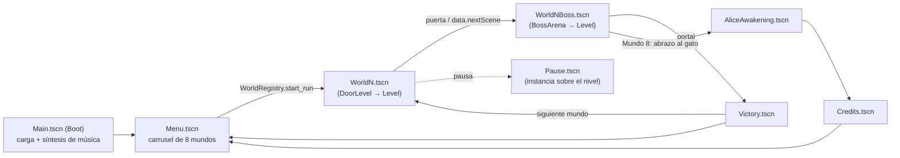
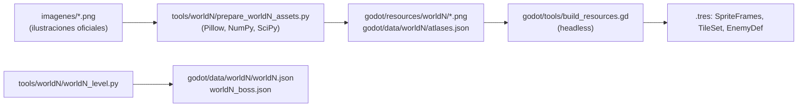

# Alice Dreams — Guardiana de los Sueños · Documento de diseño (GDD)

> **Alcance.** Este documento describe el estado **actual** de la versión Godot del juego (`godot/`), tal como está en la rama `main` (último commit `0daf384`, 2026-10-21). Se ha construido a partir del código, las escenas, los datos JSON y los informes del repositorio, y con las verificaciones automáticas que se pudieron ejecutar (ver §9.1).
>
> **Convención de evidencia** usada en todo el documento:
> - **[V]** verificado: leído en código/datos *y* cubierto por una prueba automática que pasó en esta auditoría.
> - **[C]** confirmado en código o datos, sin ejecución específica.
> - **[I]** inferencia razonada (se explica en el texto).
> - **[D]** tomado de la documentación existente del repositorio (README, informes por mundo).
>
> Nadie ha jugado el juego a mano durante esta auditoría: **no hay pruebas de jugabilidad humanas**. Toda referencia a “sensación”, “ritmo” o “dificultad percibida” es una inferencia.

Documentos relacionados: [`LEVEL_AUDIT.md`](LEVEL_AUDIT.md) · [`LEVEL_IMPROVEMENTS.md`](LEVEL_IMPROVEMENTS.md) · [`DEVELOPMENT_ROADMAP.md`](DEVELOPMENT_ROADMAP.md).

---

## 1. Identidad del videojuego

| Campo | Valor | Fuente |
|---|---|---|
| Nombre | *Alice Dreams — Guardiana de los Sueños* (`config/name`) | `godot/project.godot` [C] |
| Versión declarada | `0.1.0` | `godot/project.godot` [C] |
| Género | Plataformas 2D de desplazamiento lateral con combate a distancia (run & gun ligero) y jefes de final de mundo | código [C] |
| Motor | **Godot 4.7** (probado con 4.7.2 stable), GDScript 2.0, renderizador *GL Compatibility* | `project.godot`, `README_GODOT.md` [C][V] |
| Origen | Migración nativa de un prototipo **Phaser 3** (que sigue en `src/`, `public/`) ampliada después con los Mundos 2-8 | `README_GODOT.md`, `MIGRATION_REPORT.md` [D] |
| Estilo visual | Pixel art de estética retro (no 8-bit estricto: ver §1.1), resolución lógica **480×270**, filtro *nearest*, fuente pixel 5×7 propia | `project.godot`, `scripts/ui/pixel_font.gd` [C] |
| Público objetivo | Infantil. Los informes de los Mundos 7 y 8 se refieren explícitamente a “una niña de 7 años” como jugadora de referencia | `WORLD7_REPORT.md`, `WORLD8_REPORT.md` [D] |
| Plataforma | Windows (preset de exportación); controles táctiles opcionales | `godot/export_presets.cfg`, `scripts/ui/touch_controls.gd` [C] |
| Idioma | Español (todos los textos están escritos en el código/datos; no hay sistema de traducción) | [C] |

**Descripción general.** Alice recorre ocho reinos de sueño. Cada mundo es **un nivel largo dividido en 5 secciones (6 en el Mundo 8)**, seguido de una **arena de jefe**. Alice salta, corre, pisa monstruos y usa tres armas de juguete (Lanzaburbujas, Lanzapintura, Tirachinas). Al vencer al jefe aparece una estrella dorada especial y un portal que desbloquea el siguiente mundo.

**Objetivo del jugador.** Llegar al final de cada mundo, calmar a su jefe y, en el Mundo 8, liberar al Rey Pesadelo de su pesadilla para cerrar la aventura. Objetivos secundarios: estrellas, estrella especial, coleccionables de cada mundo y mejor tiempo.

### 1.1. Sobre la etiqueta “8-bit”

El encargo de esta auditoría habla de un juego 8-bit. Lo observado es un **pixel art de inspiración retro con paletas amplias**, no una restricción de hardware de 8 bits:

| Medida | Valor observado | Referencia 8-bit clásica |
|---|---|---|
| Colores por hoja de enemigo | 30-53 | 3 + transparente por sprite (NES) |
| Colores por hoja de jefe | 64-102 | — |
| Colores por tileset | 54-152 | 4 por bloque de 16×16 (NES) |
| Píxeles semitransparentes | 0 % en todas las hojas | — |
| Celda de Alice | 42×44 px | 16×16 / 16×32 |

(Medido con Pillow sobre `godot/resources/**`. [C])

Se recomienda tratar la dirección artística como **“pixel art retro de 16 bits suave”** y no imponer restricciones 8-bit que contradirían el arte existente (las propuestas de arte, IMP-002 e IMP-038 en `LEVEL_IMPROVEMENTS.md`, siguen este criterio).

---

## 2. Concepto y narrativa

| Elemento | Contenido | Fuente |
|---|---|---|
| Protagonista | **Alice**, niña que sueña; “Guardiana de los Sueños” | título, `player.gd` [C] |
| Mundo | Ocho reinos oníricos hechos de cosas infantiles: nubes, crayones, peluches, burbujas, trenes de juguete, estrellas, caramelos y un castillo de pesadillas | `world_registry.gd` [C] |
| Conflicto por mundo | Cada reino tiene un “jefe” que no es malvado sino un sueño alterado (Nubarrón, Garabato, Rey Siestón…). Al vencerlo **“duerme feliz”** o recupera su forma amable | `victorySub` en `world_registry.gd` [C] |
| Motivación de Alice | Devolver la calma a cada reino del sueño [I: deducida de los textos de victoria; no hay escena de introducción narrativa] |
| Objetivo final | Llegar al Trono de las Pesadillas y enfrentarse al **Rey Pesadelo** | `world8.json`, `rey_pesadelo.gd` [C] |
| Desenlace (implementado) | El Rey Pesadelo, agotado, se transforma en un **gato morado** (`NightmareTransformation`). Alice se acerca y lo abraza; el castillo recupera la luz; Alice **despierta en su habitación** con el gato junto a ella (`AliceAwakening`): “Los sueños más grandes comienzan con un poquito de valentía.” / “Gracias por jugar, Alice.” Después, créditos (`Credits`). Terminar la aventura añade “Ver el final” al menú | `scripts/levels/world8_boss_arena.gd`, `scripts/cinematics/*.gd`, `save_manager.gd` [V] (`test_w8_boss_victory_and_ending`, `test_w8_awakening_and_credits`) |

**Huecos narrativos detectados [C]:**
- No existe introducción de la historia al empezar una partida (el Mundo 1 arranca directamente con carteles de tutorial).
- Entre mundos sólo hay pantalla de victoria; no hay transición narrativa.
- Los tres “recuerdos mágicos” del Mundo 8 (`world8.gd → MEMORIES`) son el único elemento que conecta los mundos entre sí antes del final.

---

## 3. Mecánicas principales

### 3.1. Controles

Definidos en `godot/project.godot [input]` [C] y documentados en `README_GODOT.md` [D].

| Acción | Teclado | Táctil |
|---|---|---|
| Moverse | A / D, ← / → | ◀ ▶ |
| Saltar (mantener = más alto) | Espacio | A |
| Correr | Shift (mantener) | RUN |
| Disparar (Lanzaburbujas admite mantener) | J | B |
| Apuntar arriba | W / ↑ (+ J) | ▲ |
| Cambiar arma | K | ARMA |
| Pausa | Esc / P | II |
| Menús | ↑↓ / WS + Enter / Espacio / J; ratón | táctil |

**Observaciones [C]:** no hay acciones de mando (gamepad) en el Input Map; no hay reasignación de teclas; correr requiere mantener una tecla adicional (Shift) además de saltar y disparar.

### 3.2. Movimiento y física del jugador

Archivo: `godot/scripts/entities/player.gd`; valores en `godot/data/tuning.json`. [V] (`test_walk_and_run_speeds`, `test_jump_height_and_variable_jump`, `test_coyote_time`, `test_jump_buffer`).

| Parámetro | Valor |
|---|---|
| Gravedad | 900 px/s² (`C.GRAVITY`) |
| Velocidad andar / correr | 95 / 150 px/s |
| Aceleración suelo / frenado suelo | 950 / 1200 px/s² |
| Aceleración / frenado en el aire | 620 / 380 px/s² |
| Velocidad de salto / corte de salto variable | −335 / −120 px/s (altura máx. ≈ 62 px ≈ 3,9 teselas) |
| Caída máxima | 430 px/s |
| *Coyote time* / *jump buffer* | 100 ms / 120 ms |
| Hitbox | 12×30 px |
| Rebote al pisar enemigo | −250 px/s |

Modificadores de entorno que actúan sobre el jugador [C]: pintura (velocidad/fricción, rebote amarillo — Mundo 2), somnolencia (−28 % velocidad — Mundo 3), agua (gravedad ×0,32, brazadas — Mundo 4), tobogán (Mundo 6, archivos `world5`), correas (Mundo 7), ralentización (Mundo 8), empujes de viento.

### 3.3. Combate

**Armas** (`godot/data/weapons/weapons.json`, `scripts/weapons/weapon_manager.gd`, `scripts/weapons/projectile.gd`) [V] (`test_weapons`, `test_bubble_traps_and_star`, `test_paint_and_sling_damage`):

| Arma | Cadencia | Efecto vs. enemigos | Daño a jefes | Notas |
|---|---|---|---|---|
| Lanzaburbujas | 230 ms, admite mantener | **Atrapa** al enemigo en una burbuja (3,5 s); un segundo impacto o tocarlo lo convierte en estrella extra | 1 | Ignora la vida del enemigo |
| Lanzapintura | 380 ms | 1 de daño + ralentiza (×0,55) 2,5 s | 2 | Rastro de color |
| Tirachinas | 650 ms | 2 de daño, trayectoria en arco, retroceso | 3 | Sacude la cámara |

- Apuntar arriba dispara en diagonal (≈45°).
- Pisar a un enemigo hace 1 de daño y rebota a Alice (`level.gd → on_player_touch_enemy`).
- En el Mundo 1 las armas se recogen en el nivel (`pickups`); **del Mundo 2 en adelante se empieza con las tres** (`startWeapons`) [C].
- Límite de proyectiles activos: 24 del jugador, 48 enemigos (`level.gd → spawn_projectile`) [C].

### 3.4. Salud, daño y derrota

| Sistema | Estado | Detalle |
|---|---|---|
| Vida | Implementado [V] | 3 corazones (`maxHp`) |
| Invulnerabilidad tras golpe | Implementado [V] | 1300 ms con parpadeo; aturdimiento 350 ms; retroceso (150, −170) |
| Caída al vacío | Implementado [V] (`test_fall_respawn_checkpoint`) | −1 corazón y reaparición **en el último checkpoint** (`level.gd → handle_fall`) |
| Desmayo (0 corazones) | Implementado [C] | Reaparece en el último checkpoint con la vida completa |
| Vidas / *Game Over* | **No implementado** [C] | No existe contador de vidas ni pantalla de *game over*: la derrota no tiene más coste que volver al checkpoint |
| Recuperar vida | Implementado [C] | Al activar un checkpoint (vida completa); corazones recogibles sólo en Mundos 7 (4) y 8 (6 en nivel) |
| Derrota en arena de jefe | Implementado [C] | La arena se recarga entera con la vida completa (`boss_arena.gd → respawn`) |

### 3.5. Checkpoints

`scripts/systems/checkpoint_manager.gd`, `scripts/objects/checkpoint.gd` [V]. Bandera que guarda la posición en `GameState` (sobrevive a “Volver al checkpoint”) y recupera toda la vida. **Dos por nivel en los Mundos 1-7 y tres en el Mundo 8**; ninguno en las arenas (ver `LEVEL_AUDIT.md` §2).

### 3.6. Progresión, coleccionables y victoria

| Elemento | Detalle | Fuente |
|---|---|---|
| Secciones | 5 por nivel (A-E); el Mundo 8 tiene F en la arena. Cartel al entrar en cada una | datos `sections` [C] |
| Estrellas | 138-298 por nivel + 6-22 en la arena; las estrellas extra salen de monstruos atrapados | datos `stars` [C] |
| Estrella dorada especial | La suelta el jefe al ser derrotado; abre el portal | `boss_arena.gd` [V] |
| Coleccionables de mundo | Crayones mágicos (M2), lunas y botones (M3), conchas y otros (M4), billetes (M5), fichas de luna (M6), caramelos (M7), fragmentos de luna, orbe, llave, recuerdos y cofre (M8). Reunir el tipo principal da una estrella extra | `level.gd → on_dream_collectible` [C] |
| Victoria de mundo | Tocar el portal → guardado → pantalla `Victory` (estrellas, tiempo, coleccionables) | `boss_arena.gd → enter_portal`, `scripts/ui/victory.gd` [V] |
| Desbloqueo | Completar el mundo *N* desbloquea *N+1* (máx. 8) | `save_manager.gd → mark_world_completed` [V] |

### 3.7. Pantallas de transición

Fundidos de pantalla (`Fader`, autoload) en cada cambio de escena; banner y *toast* del HUD para secciones, checkpoints, armas y coleccionables [C].

---

## 4. Arquitectura técnica

### 4.1. Estructura del proyecto

```text
alice-dreams/
├── godot/                     ← juego Godot (lo auditado)
│   ├── project.godot          480×270, stretch "viewport", capas, Input Map, autoloads
│   ├── data/                  datos generados (JSON): mundos, jefes, enemigos, armas, atlas, tuning
│   ├── resources/             PNG + SpriteFrames/TileSet/WeaponDef/EnemyDef (.tres), audio, shaders
│   ├── scenes/                63 escenas .tscn (mundos, arenas, jefes, enemigos, UI, cinemáticas, tests)
│   ├── scripts/               ~23 000 líneas GDScript (incluye tests)
│   ├── tests/                 CheckAll, Tests (run_tests.gd, 4116 líneas), Autopilot, Capture
│   └── tools/                 convert_phaser.mjs, build_resources.gd
├── tools/                     pipelines Python de recursos y niveles por mundo (world2…world8, menu)
├── imagenes/                  ilustraciones fuente oficiales (89 MB)
├── src/, public/, index.html  prototipo Phaser 3 original (sigue funcionando con npm)
└── WORLD*_REPORT.md, MIGRATION_*.md, README*.md
```

### 4.2. Autoloads (servicios globales)

| Autoload | Archivo | Responsabilidad |
|---|---|---|
| `Assets` | `scripts/core/assets.gd` | Catálogo de SpriteFrames, atlas, armas, enemigos, tuning |
| `SaveManager` | `scripts/core/save_manager.gd` | Persistencia en `user://save.json` (versión 2, migración 1→2, copia `.bad` si está dañado) |
| `AudioManager` | `scripts/core/audio_manager.gd` | Eventos de sonido por nombre; música por pista; síntesis de respaldo (`synth.gd`) en un hilo |
| `GameState` | `scripts/core/game_state.gd` | Estado de la partida (equivalente al *registry* de Phaser) + señales `changed`, `banner`, `toast` |
| `Fader` | `scripts/core/fader.gd` | Fundidos |

Además, clases estáticas: `Router` (cambio de escena por clave), `WorldRegistry` (tabla de los 8 mundos), `C` (constantes), `Anim`, `Timers`, `StateMachine`.

### 4.3. Flujo de escenas



### 4.4. Motor de nivel (data-driven)

Todos los mundos comparten **un único motor** (`scripts/levels/level.gd`, 639 líneas). Cada escena de mundo es un `Node2D` con un script mínimo y dos propiedades (`data_path`, `scene_key`). El contenido sale del JSON.

```mermaid
classDiagram
    class Level {
      +data: Dictionary
      +now: float (ms, se para en pausa)
      _process_overlaps()
      respawn() / handle_fall()
      on_create() on_update() on_respawn()
      on_custom_overlap()
    }
    Level <|-- DoorLevel
    Level <|-- BossArena
    DoorLevel <|-- World1..World8
    BossArena <|-- World8BossArena
    Level --> LevelBuilder : construye desde JSON
    Level --> Player
    Level --> WeaponManager
    Level --> EnemySpawner
    Level --> CheckpointManager
    Level --> CameraRig
    Level --> ParallaxBackground2
    Level --> HUD
    EnemySpawner --> Enemy
    Enemy <|-- ScratchMonster
    Enemy <|-- "…22 IA más"
```

- **`LevelBuilder`** (`scripts/levels/level_builder.gd`, 536 líneas) crea el `TileMapLayer` con autotiling y todos los objetos a partir de claves del JSON (`clouds`, `rulers`, `waters`, `trains`, `belts`, `ghostPlatforms`…).
- **Colisiones con la protagonista:** no se usan señales; `Level._process_overlaps()` recorre cada fotograma las áreas que tocan el sensor de Alice y despacha por `meta("kind")`. Los mundos añaden tipos en `on_custom_overlap()`.
- **Reloj propio:** `Level.now` (ms) y `Timers` sustituyen a `Timer`/`SceneTreeTimer` para que todo se detenga con la pausa.
- **Enemigos:** `EnemySpawner` los crea al acercarse la cámara (fuera del encuadre), máximo **6 activos**, y no reaparecen una vez derrotados.
- **Jefes:** 8 scripts independientes (`scripts/entities/<jefe>.gd`, 190-552 líneas) que comparten una interfaz implícita (`setup`, `intro`, `hit_by`, `fsm`, `hp`, `max_hp`, `defeated_at`, `is_defeated`, `set_body_enabled`, `invulnerable`) **sin clase base común** [C].

### 4.5. Capas de colisión

`project.godot [layer_names]` y `scripts/core/constants.gd` [C]: 1 `world`, 2 `one_way`, 3 `player`, 4 `enemy_body`, 5 `enemy_hitbox`, 6 `player_projectile`, 7 `enemy_projectile`, 8 `trigger`, 9 `boss`.

### 4.6. Resolución y escalado

| Ajuste | Valor | Comentario |
|---|---|---|
| Viewport | 480×270 | |
| Ventana inicial | 1440×810 (×3) | |
| `stretch/mode` | `viewport` | Correcto para pixel art |
| `stretch/scale_mode` | *no definido* (por defecto `fractional`) | En resoluciones no múltiplo (p. ej. 1366×768) los píxeles no son uniformes [C] |
| Filtro de textura | `nearest` (0) | |
| *Snap* de transformaciones y vértices a píxel | activados | |

### 4.7. Guardado

`user://save.json` [V] (`test_save_manager`): `unlockedWorld`, por mundo `{completed, bestStars, totalStars, specialStar, bestTime, completedAt, magicCrayons?, dreamCollectibles?}`, `settings {music, sfx}`, `adventureCompleted`. Carga tolerante a archivos dañados. No se guarda el progreso **dentro** de un nivel (cerrar el juego a mitad de mundo obliga a empezarlo de nuevo) [C].

### 4.8. Pipeline de contenido



Los niveles **se generan desde Python**: editar el JSON a mano se perdería al regenerar [D] (`README_GODOT.md` §4-5).

### 4.9. Numeración de mundos (riesgo de confusión)

El número que ve el jugador no coincide con el nombre de archivo en dos mundos [C] (`world_registry.gd`, `save_manager.gd` versión 2):

| Mundo (jugador) | Nombre | Escena / datos |
|---|---|---|
| 5 | El Reino del Tren de Juguete | `World6.tscn`, `data/world6/`, `Boss6` |
| 6 | Sueños Cósmicos — Islas en el Cielo | `World5.tscn`, `data/world5/`, `Boss5` |

En el resto de documentos se indica siempre el número de jugador y, entre paréntesis, los archivos.

---

## 5. Personajes

### 5.1. Personaje jugable

| Campo | Detalle |
|---|---|
| Nombre | Alice |
| Escena / script | `scenes/player/Player.tscn`, `scripts/entities/player.gd`, `scripts/entities/player_animator.gd` |
| Sprite | `resources/player/player.png`, celda 42×44 |
| Animaciones | `idle`, `blink`, `walk`, `run`, `jump`, `fall`, `hurt`, `victory`, `bubble`, `paint`, `sling` |
| Habilidades | Andar, correr, salto variable, pisotón, nadar, 3 armas, apuntar arriba |
| Estado | Implementado y verificado [V] |

### 5.2. Enemigos

Todos heredan de `Enemy` (`scripts/entities/enemy.gd`: estados IDLE, PATROL, ALERT, ATTACK, HURT, TRAPPED, DEFEATED; icono “!” al detectar; `telegraph()` como aviso). Estadísticas en `data/**/enemies.json`. Todos tienen pruebas de IA y de armas contra ellos en la suite [V].

| Mundo | Enemigo (`tipo`) | Script | Vida | Enfriamiento ataque | Comportamiento |
|---|---|---|---|---|---|
| 1 | Arañitas (`scratch`) | `ai/scratch_monster.gd` | 2 | 900 ms | Persigue y araña de cerca |
| 1 | Escupitín (`spit`) | `ai/spit_monster.gd` | 3 | 1500 ms | Mantiene distancia y escupe |
| 1 | Pulgoso (`flea`) | `ai/flea_monster.gd` | 3 | 1700 ms | Retrocede y lanza pulgas en parábola |
| 2 | Borrador saltarín (`eraser`) | `ai/eraser_monster.gd` | 2 | 1300 ms | Salta, embiste; **borra puentes de reglas** |
| 2 | Crayón guerrero (`crayon`) | `ai/crayon_monster.gd` | 3 | 1400 ms | Carga con aviso y golpe corto |
| 2 | Pincel travieso (`brush`) | `ai/brush_monster.gd` | 3 | 1600 ms | Distancia; disparos sueltos y ráfagas de 3 |
| 3 | Peluche saltarín (`rabbit`) | `ai/rabbit_monster.gd` | 2 | 1450 ms | Hasta dos saltos hacia Alice |
| 3 | Ovillo viviente (`wool`) | `ai/wool_monster.gd` | 3 | 1600 ms | Embiste y queda aturdido |
| 3 | Almohada voladora (`pillow`) | `ai/pillow_monster.gd` | 3 | 1700 ms | Vuela, dispara estrellas, embiste |
| 4 | Pez Burbuja (`bubble_fish`) | `ai/bubble_fish.gd` | 2 | 1900 ms | Nada y lanza burbuja lenta |
| 4 | Cangrejito Esponja (`sponge_crab`) | `ai/sponge_crab.gd` | 3 | 1300 ms | Avanza a pasitos y pinza |
| 4 | Pompa Traviesa (`pompa`) | `ai/pompa.gd` | 2 | 2400 ms | Se acerca, estalla en abanico |
| 5 | Payasito Resorte (`payasito`) | `ai/payasito.gd` | 2 | 2200 ms | Salta de su caja y lanza estrellas |
| 5 | Bloquecito Travieso (`bloquecito`) | `ai/bloquecito.gd` | 3 | 1800 ms | Embestida con aviso |
| 5 | Vagoncito Chispa (`vagoncito`) | `ai/vagoncito.gd` | 3 | 2100 ms | Ciclo fijo de 3 ataques |
| 6 | Estrellita Fugaz (`estrellita`) | `ai/estrellita.gd` | 2 | 1700 ms | Vuela en grupo, miniestrella |
| 6 | Meteorito Travieso (`meteorito`) | `ai/meteorito.gd` | 3 | 1800 ms | Rueda, embiste en pendientes |
| 6 | Cohetito Centinela (`cohetito`) | `ai/cohetito.gd` | 3 | 2000 ms | Patrulla aérea, rayo recto |
| 7 | Cuppy Dulzón (`cuppy`) | `ai/cuppy.gd` | 3 | 2000 ms | Saltitos y caramelo |
| 7 | Gomilito Saltarín (`gomilito`) | `ai/gomilito.gd` | 4 | 1700 ms | Plancha; **se divide** en gomitas (`gomilito_mini`, 1 PV) |
| 7 | Piruleta Voladora (`piruleta`) | `ai/piruleta.gd` | 2 | 2300 ms | Vuela, caramelos en abanico |
| 8 | Fantasmita Farol (`fantasmita`) | `ai/fantasmita.gd` | 2 | 2400 ms | Flota, estrellita con aviso del farol |
| 8 | Murcibola de Trapo (`murcibola`) | `ai/murcibola.gd` | 2 | 2600 ms | Se sitúa al lado y se lanza en picada |
| 8 | Bloquito Sombra (`bloquito`) | `ai/bloquito_sombra.gd` | 4 | 2200 ms | Embiste; **barrera** que refleja disparos |

Las animaciones disponibles de cada uno están en `data/**/characters.json` (todas tienen al menos idle/walk o fly/attack/hurt/defeated o equivalentes; los del Mundo 8 usan `defeat` y se traducen en su script) [C].

### 5.3. Jefes

| Mundo | Jefe | Script | PV | Fases | Ataques (estados) |
|---|---|---|---|---|---|
| 1 | Nubarrón | `entities/nubarron.gd` | 40 | 3 (65 %, 30 %) | WIND, SHOOT, TRIPLE, RAIN, SUMMON (nubes temporales), DASH |
| 2 | Garabato | `entities/garabato.gd` | 48 | 3 | SHOOT, SPLASH, SWIRL, ORBIT, RAIN, BIG_SWIRL, PAINT_FLOOR |
| 3 | Rey Siestón | `entities/rey_sieston.gd` | 50 | 3 | PILLOW, DOUBLE, HOP, WAVE, CLOUD, SPIN, RAIN |
| 4 | Rey Patoburbuja | `entities/rey_patoburbuja.gd` | 50 | 3 | SPIT, SLAP, BIG_BUBBLE, WAVE, SMALL_WHIRL, WHIRL, RAIN, COMBO |
| 5 | Locomostro | `entities/locomostro.gd` | 60 | 3 | SMOKE, DOUBLE_SMOKE, WHIRLS, BLOCK_TOSS, MULTI_BLOCKS, CHARGE, COMBO, EXPRESS |
| 6 | Luna Estelar | `entities/luna_estelar.gd` | 50 | 3 | STAR_SHOT, DASH, SPIN, ORBIT, WAVE, COSMIC, STARFALL, SPIN_RING, MULTI_SHOT |
| 7 | Don Chupetón | `entities/don_chupeton.gd` | 65 | 3 | CANDY_SHOT, LOLLIPOP, FROSTING_JET, CANDY_FAN, SWIRLS, SPIN, COMBO, FROSTING_BURST, MULTI |
| 8 | Rey Pesadelo | `entities/rey_pesadelo.gd` | 80 | 3 | SPIT, CLAW, SLOW_CLOUD, FURY_SCREAM, COMBO → TRANSFORMING → gato |

Patrón común [C]: INTRO invulnerable → ciclo de ataques con aviso (“!”, destello, pose) → **REST/STUNNED** con brillo dorado → cambio de fase invulnerable con *toast*. Todos tienen pruebas de fases, ataques y derrota [V].

> **Observación importante [C]:** el jefe sólo es invulnerable durante INTRO, el cambio de fase y la derrota. **Recibe daño también mientras ataca**; la “ventana de vulnerabilidad” (REST) es una pausa de sus ataques, no la única oportunidad de hacerle daño.

### 5.4. Personajes no hostiles

Gato morado (`resources/world8/boss/gato_morado.png`, `scripts/cinematics/purple_cat.gd`): forma real del Rey Pesadelo; animaciones `idle`, `blink`, `sit`, `walk`, `purr`, `sleep` [C].

---

## 6. Mundos y niveles

Resumen (datos extraídos de los JSON; densidad = enemigos por 1000 px):

| # | Nombre | Escena nivel / arena | Ancho | Secciones | Enemigos (densidad) | Checkpoints | Estrellas | Jefe (PV) |
|---|---|---|---|---|---|---|---|---|
| 1 | El Reino de las Nubes de Algodón | `World1` / `World1Boss` | 7600 px | 5 | 13 (1,7) | 2 | 138 + 6 | Nubarrón (40) |
| 2 | El Reino de los Crayones Encantados | `World2` / `World2Boss` | 7584 px | 5 | 14 (1,8) | 2 | 152 + 10 | Garabato (48) |
| 3 | El Reino de los Peluches Dormilones | `World3` / `World3Boss` | 9040 px | 5 | 18 (2,0) | 2 | 162 + 6 | Rey Siestón (50) |
| 4 | Reino de las Burbujas | `World4` / `World4Boss` | 9040 px | 5 | 22 (2,4) | 2 | 197 + 6 | Rey Patoburbuja (50) |
| 5 | El Reino del Tren de Juguete | `World6` / `World6Boss` | 10080 px | 5 | 20 (2,0) | 2 | 237 + 9 | Locomostro (60) |
| 6 | Sueños Cósmicos — Islas en el Cielo | `World5` / `World5Boss` | 9552 px | 5 | 30 (3,1) | 2 | 240 + 6 | Luna Estelar (50) |
| 7 | El Valle de Caramelo | `World7` / `World7Boss` | 10496 px | 5 | 20 (1,9) | 2 | 298 + 9 | Don Chupetón (65) |
| 8 | El Castillo de las Pesadillas | `World8` / `World8Boss` | 10000 px | 6 (F en la arena) | 24 (2,4) | 3 | 282 + 22 | Rey Pesadelo (80) |

Todos los niveles miden 25 teselas de alto (400 px) y las arenas 17 (272 px). Condición de victoria común: cruzar la puerta del nivel → vencer al jefe → recoger la estrella especial → entrar en el portal. Estado de implementación de los ocho: **completo y jugable de principio a fin según las pruebas automáticas** [V]; jugabilidad humana no verificada.

### 6.1. Mundo 1 — El Reino de las Nubes de Algodón
- **Datos:** `data/worlds/world1.json`, `data/worlds/world1_boss.json`. **Script:** `scripts/levels/world1.gd`.
- **Secciones:** A Bienvenida · B Jardines de algodón · C Puentes del arcoíris · D Cascadas de sueños · E Castillo de Nubarrón.
- **Mecánicas/obstáculos:** nubes atravesables y elásticas, puentes, plataformas móviles, nubes de vapor que se deshacen, cojín de burbujas, corriente de aire, 2 peligros. **Recogida de las 3 armas** (teselas 78, 177, 283) con carteles tutoriales.
- **Enemigos:** Arañitas ×5, Escupitín ×4, Pulgoso ×4.
- **Recursos:** `resources/tilesets/world1/`, `resources/backgrounds/world1/`, música `mundo_1.mp3`, `jefe_mundo_1.mp3`.

### 6.2. Mundo 2 — El Reino de los Crayones Encantados
- **Datos:** `data/world2/world2.json`, `world2_boss.json`.
- **Secciones:** A Escritorio gigante · B Jardín de crayones · C Río de pintura · D Fábrica de dibujos · E El Gran Lienzo.
- **Mecánicas:** reglas-puente (algunas inclinadas), puentes dibujados que parpadean, molinillo que dibuja puentes, pintura azul (resbala), amarilla (rebota), rosa (pegajosa), lápices rodantes, borradores que rebotan, goteos, ríos de pintura, 3 crayones mágicos.
- **Enemigos:** Borrador ×4, Crayón ×5, Pincel ×5.
- **Recursos:** `resources/world2/`. **Audio:** existen `mundo_2.mp3` y `jefe_mundo_2.mp3` en `resources/audio/` pero **no están conectados** (ver §8).

### 6.3. Mundo 3 — El Reino de los Peluches Dormilones
- **Datos:** `data/world3/world3.json`, `world3_boss.json`.
- **Secciones:** A El rincón de los juguetes · B Los puentes de lana · C Las almohadas flotantes · D El laberinto de las mantas · E El castillo de los sueños.
- **Mecánicas:** almohadas elásticas, cuerdas columpio, ovillos rodantes, nubes que se deshacen, nubes de sueño (ralentizan), botón mágico que activa un ascensor de nube; 3 lunas + 3 botones dorados.
- **Enemigos:** Peluche saltarín ×7, Ovillo ×5, Almohada ×6.

### 6.4. Mundo 4 — Reino de las Burbujas
- **Datos:** `data/world4/world4.json`, `world4_boss.json`.
- **Secciones:** A Las bañeras de espuma · B Los jardines del jabón · C El canal de los patitos · D Las cataratas de burbujas · E El trono de Patoburbuja.
- **Mecánicas:** **agua con natación** (5 zonas), géiseres, columnas de burbujas, rodillos de esponja, jabones deslizantes, espuma resbaladiza, rampas; conchas (principal), estrella de mar, arcoíris, patito.
- **Enemigos:** Pez Burbuja ×9, Cangrejito ×7, Pompa ×6.

### 6.5. Mundo 5 — El Reino del Tren de Juguete (archivos `world6`)
- **Datos:** `data/world6/world6.json`, `world6_boss.json`. **Script:** `scripts/levels/world6.gd` (cámara especial en tren).
- **Secciones:** A La Estación de los Sueños · B Los Puentes del Arcoíris · C El Ferrocarril de las Nubes · D La Fábrica de Juguetes · E La Gran Estación Real.
- **Mecánicas:** **trenes con vías, estaciones y desvíos** (7 líneas), palancas, campanas, plataformas con hélice, arcos arcoíris, bloques que caen, ruedas rodantes, barreras de estrella, tren peligroso de túnel con señal, bloques de estrella (cabezazo); 3 billetes dorados.
- **Enemigos:** Bloquecito ×9, Payasito ×7, Vagoncito ×4.

### 6.6. Mundo 6 — Sueños Cósmicos, Islas en el Cielo (archivos `world5`)
- **Datos:** `data/world5/world5.json`, `world5_boss.json`. **Script:** `scripts/levels/world5.gd` (tobogán y nubes explosivas).
- **Secciones:** A El observatorio de las nubes · B El camino de la luna · C Los jardines planetarios · D La lluvia de meteoros · E El trono de la Luna.
- **Mecánicas:** estrellas sólidas y trampolín, lunas fijas/móviles/en órbita, toboganes arcoíris, cohetes, cascadas de luz ascendentes, estrellas que caen con aviso, nubes explosivas; fichas de luna, especial, constelación, cohete.
- **Enemigos:** Estrellita ×13, Cohetito ×8, Meteorito ×9 (el mundo más denso).

### 6.7. Mundo 7 — El Valle de Caramelo
- **Datos:** `data/world7/world7.json`, `world7_boss.json`. **Script:** `scripts/levels/world7.gd`.
- **Secciones:** A Jardines de Algodón de Azúcar · B Los Puentes de Caramelo · C El Río de Chocolate · D La Fábrica de Caramelos · E El Castillo del Gran Pastel.
- **Mecánicas:** gelatinas elásticas, gomas elásticas, caramelo resbaladizo, chocolate pegajoso, correas transportadoras (una invertida), piruletas giratorias, lanzadores de caramelos, chorros de chocolate, gelatinas que desaparecen, bloques de premio, tobogán de caramelo, **4 corazones**; caramelos especiales, cereza, pastel.
- **Enemigos:** Gomilito ×6, Cuppy ×8, Piruleta ×6.

### 6.8. Mundo 8 — El Castillo de las Pesadillas (final)
- **Datos:** `data/world8/world8.json`, `world8_boss.json`, `credits.json`. **Scripts:** `scripts/levels/world8.gd`, `scripts/levels/world8_boss_arena.gd`, `scripts/cinematics/*`.
- **Secciones:** A El Bosque de los Susurros · B Los Puentes de la Luna · C El Jardín de las Sombras · D Las Torres Encantadas · E El Corazón del Castillo · F El Trono de las Pesadillas (arena).
- **Mecánicas:** plataformas fantasma con aviso, plataformas colgantes, estrellas que caen, plataformas que se caen, setas elásticas, charcos y bruma de sombras (daño por intervalo), ganchos en cadena, faroles que revelan puentes ocultos, llave y cofre, 3 recuerdos mágicos con visión de los mundos anteriores, **6 corazones**, gran puerta animada.
- **Enemigos:** Fantasmita ×9, Bloquito Sombra ×8, Murcibola ×7.
- **Final:** transformación, gato, despertar y créditos (ver §2).

---

## 7. Sistemas de interfaz

| Pantalla | Escena / script | Contenido | Estado |
|---|---|---|---|
| Arranque | `scenes/main/Main.tscn`, `scripts/ui/boot.gd` | Pantalla de carga mientras se sintetiza la música | [C] |
| Menú principal | `scenes/menus/Menu.tscn`, `scripts/ui/menu.gd`, `world_carousel.gd`, `world_card.gd`, `world_data.gd` | Ilustración `menu_bg.png`, **carrusel de los 8 mundos** (bloqueado / desbloqueado / completado), Música Sí/No, Efectos Sí/No, Borrar progreso (con confirmación), “Ver el final” tras completar la aventura | [V] (`test_menu_art`, `test_world_carousel`, `test_menu_keyboard`) |
| HUD | `scenes/ui/HUD.tscn`, `scripts/ui/hud.gd` | Corazones, arma e indicadores, estrellas, barra de progreso con marcas de sección, sección actual, vida del jefe, coleccionables del mundo, banner y *toast* | [C] |
| Pausa | `scenes/menus/Pause.tscn`, `scripts/ui/pause_menu.gd` | Continuar, Volver al checkpoint, Música, Efectos, Salir al menú | [V] (`test_pause_resume`) |
| Victoria | `scenes/menus/Victory.tscn`, `scripts/ui/victory.gd` | Título y subtítulo del mundo, jefe calmado, estrellas, tiempo, coleccionables, siguiente mundo / menú | [V] |
| Game over | — | **No existe** (ver §3.4) | No implementado |
| Selección de nivel | Integrada en el carrusel del menú | Sólo mundo completo; no hay selección de sección | [C] |
| Controles táctiles | `scripts/ui/touch_controls.gd` | 8 botones virtuales | [C] Sin prueba en dispositivo real [D] |

**Carteles [V en captura]:** los bocadillos de los carteles (`scripts/objects/sign_post.gd`) se ajustan en vertical pero no en horizontal; el primer cartel de los Mundos 5, 7 y 8 (tesela 3) aparece cortado por el borde izquierdo (IMP-036).

**Duplicidad detectada [C]:** los nombres cortos de los mundos están en dos sitios con valores distintos: `WorldRegistry.WORLDS[].short` (“Reino de las Burbujas”) y `WorldData.CATALOG` (“Océano de Burbujas”).

---

## 8. Audio

| Aspecto | Estado | Detalle |
|---|---|---|
| Sistema | Implementado [C] | `AudioManager` con buses Music/SFX, 10 voces, antirrebote de 35 ms, *ducking* en pausa |
| Efectos de sonido | **Todos sintetizados** (provisionales) [C] | 56 eventos definidos en `scripts/core/synth.gd`; los 56 se usan y todos los usados existen (comprobado en esta auditoría). `AudioConfig.SFX_FILES` está vacío |
| Música con archivo real | 3 pistas [C] | `menu_principal.mp3` (menú), `mundo_1.mp3` (Mundo 1), `jefe_mundo_1.mp3` (Nubarrón) |
| Música sintetizada | 24 pistas [C] | Mundos 2-8, jefes 2-8, victorias, transformación, despertar, créditos |
| **Archivos huérfanos** | [C] | `resources/audio/mundo_2.mp3` y `resources/audio/jefe_mundo_2.mp3` existen pero ninguna ruta los referencia: `AudioConfig.MUSIC_FILES["world2"/"garabato"]` está vacío y `OPTIONAL_MUSIC` busca `world2_theme.ogg` / `garabato_boss.ogg` |
| Pistas opcionales esperadas | [C] | `OPTIONAL_MUSIC` lista 24 `.ogg` (p. ej. `world7_theme.ogg`, `rey_pesadelo_fury.ogg`) que no existen todavía |
| Escucha humana | No realizada [D] | Ningún informe confirma haber escuchado la síntesis |

---

## 9. Estado general de desarrollo

### 9.1. Verificaciones ejecutadas en esta auditoría (Godot 4.7.2, headless)

| Verificación | Comando | Resultado |
|---|---|---|
| Carga de todos los scripts, escenas y recursos | `res://tests/CheckAll.tscn` | **0 fallos** |
| Suite automática | `--fixed-fps 60 res://tests/Tests.tscn` | **131 pruebas, 1488 comprobaciones correctas, 0 fallidas**. Único error en stderr: el JSON corrupto que `test_save_manager` provoca a propósito |
| Piloto automático por mundo | `res://tests/Autopilot.tscn -- world=N` (con y sin `godmode`) | Con invulnerabilidad llega a la puerta en los Mundos 1, 2, 3, 4, 6 y 7; en el **5** sólo con más tiempo (313 s, 49 caídas) y en el **8 no pasa de la tesela 140** (determinista, contradice `WORLD8_REPORT.md`). Detalle en `LEVEL_AUDIT.md` §1.3 |
| Capturas renderizadas | `res://tests/Capture.tscn` (OpenGL, Intel UHD 730) | 8 niveles + menú. Revelan el bocadillo del primer cartel recortado (Mundos 5, 7, 8). La captura del menú terminó con *access violation* al cerrar el proceso (ya descrito para los créditos en `WORLD8_REPORT.md`) |

Nota técnica: el lanzador `Godot_v4.7.2-stable_win64_console.exe` de la máquina falla con *CreateProcess error 193* porque está dentro de una carpeta llamada `Godot_v4.7.2-stable_win64.exe`; se usó el ejecutable principal.

### 9.2. Matriz de mecánicas

| Mecánica | Estado | Implementación | Problemas | Mejora sugerida |
|---|---|---|---|---|
| Movimiento, carrera | Implementada y verificada | `player.gd`, `tuning.json` | Correr exige mantener Shift | Opción de “correr siempre” (IMP-019) |
| Salto variable, coyote, buffer | Implementada y verificada | `player.gd` | — | — |
| Gravedad / colisiones / one-way | Implementada y verificada | `CharacterBody2D`, capas 1-9 | — | — |
| Armas y proyectiles | Implementada y verificada | `weapon_manager.gd`, `projectile.gd` | El Lanzaburbujas neutraliza a cualquier enemigo en 2 impactos | IMP-006 |
| Ataques enemigos | Implementada y verificada | `scripts/ai/*.gd` | Enfriamientos más largos en mundos avanzados | IMP-007 |
| Salud, daño, invulnerabilidad | Implementada y verificada | `player.gd → hurt` | — | Feedback adicional (IMP-020) |
| Sistema de vidas | **No implementada** | — | Sin coste de fallo más allá de volver al checkpoint | Decisión de diseño: ver IMP-021 |
| Power-ups | Implementada parcialmente | Armas (sólo Mundo 1), corazones (Mundos 7-8), estrellas extra | Del Mundo 2 en adelante no hay power-ups nuevos | IMP-018 |
| Checkpoints | Implementada y verificada | `checkpoint_manager.gd` | 2-3 por nivel de 7600-10500 px; en los Mundos 2 y 8 el checkpoint está justo **después** del obstáculo más difícil | IMP-001, IMP-010, IMP-037 |
| Progresión de niveles | Implementada y verificada | `save_manager.gd`, `world_registry.gd` | Curva no monótona tras renumerar 5↔6 | IMP-004 |
| Combates contra jefes | Implementada y verificada (automática) | 8 scripts de jefe | Sin clase base; daño fuera de la ventana REST | IMP-003, IMP-005 |
| Victoria / derrota | Implementada (sin *game over*) | `boss_arena.gd`, `victory.gd` | — | — |
| Pantallas de transición | Implementada | `Fader`, banners | Sin intro narrativa ni transiciones entre mundos | IMP-022 |
| Guardado | Implementada y verificada | `save_manager.gd` | No guarda progreso dentro del nivel | IMP-016 |
| Controles táctiles | Detectada en código, sin verificar ejecución en dispositivo | `touch_controls.gd` | — | — |
| Mando (gamepad) | No implementada | — | — | IMP-017 |

### 9.3. Resumen

- **Completo:** los ocho mundos, sus arenas, el final, menú, pausa, victoria, guardado y la suite de pruebas.
- **Parcial:** audio (síntesis provisional salvo 3 pistas), arte del menú (islas provisionales recortadas del mapa, `WorldData`), créditos (nombres pendientes de confirmar, `credits.json`).
- **Pendiente:** pruebas humanas, mando, *game over*/vidas (si se desea), escalado entero.
- **No verificado:** sensación de control, dificultad real, legibilidad de avisos para la edad objetivo, táctil en dispositivo.

---

## 10. Riesgos y deuda técnica

| # | Riesgo / deuda | Evidencia | Impacto |
|---|---|---|---|
| R1 | **Jefes sin clase base**: 8 scripts de 190-552 líneas (≈3 600 en total) repiten `hit_by`, cambio de fase, destello, `REST`, `defeated_at`, etc. | `scripts/entities/{nubarron,garabato,…}.gd` | Un cambio de reglas (p. ej. daño sólo en REST) hay que hacerlo 8 veces |
| R2 | **Esquema de datos acumulativo**: cada JSON de mundo contiene las claves de todos los mundos anteriores (vacías) y `LevelBuilder.build()` crece con cada mundo | claves de `world8.json` (§6) ; `level_builder.gd` | El builder y los JSON crecerán linealmente con cada mecánica |
| R3 | **Niveles generados por Python**: los JSON se sobrescriben al regenerar | `tools/worldN/worldN_level.py` | Ediciones a mano en el JSON se pierden; hay que editar el generador |
| R4 | **Numeración 5↔6 cruzada** entre nombres de archivo e ids | §4.9 | Errores al tocar el mundo equivocado |
| R5 | `_process_overlaps` con `match` creciente en `level.gd` + `on_custom_overlap` por mundo | `level.gd` L188-238 | Acoplamiento del motor a mecánicas concretas (agua, pintura…) |
| R6 | `Anim.play` ignora en silencio las animaciones inexistentes | `scripts/core/anim.gd` | Errores de nombres de animación invisibles |
| R7 | Suite de pruebas en un único archivo de 4 116 líneas | `tests/run_tests.gd` | Difícil de mantener; tiempos de ejecución crecientes |
| R8 | Datos duplicados del catálogo de mundos | `world_registry.gd` vs `world_data.gd` | Nombres inconsistentes en UI |
| R9 | Audio provisional + archivos huérfanos | §8 | Experiencia sonora no final |
| R10 | Escalado fraccional | §4.6 | Píxeles irregulares en monitores comunes |
| R11 | Sin pruebas humanas | todos los informes | Dificultad y legibilidad no validadas para la edad objetivo |
| R12 | Repositorio híbrido Phaser + Godot | `src/`, `public/`, `node_modules/` | Confusión sobre cuál es la versión “oficial” |
| R13 | Estilo de código heterogéneo (p. ej. `rey_sieston.gd` usa sentencias encadenadas con `;` en una línea) | `scripts/entities/rey_sieston.gd` | Legibilidad |
| R14 | Validación automática desactualizada: el piloto del Mundo 8 ya no completa el nivel, aunque su informe dice lo contrario; el piloto no forma parte de la suite que se ejecuta habitualmente | `LEVEL_AUDIT.md` §1.3 | Regresiones de diseño de nivel pueden pasar sin detectarse |
| R15 | Avisos del motor al salir del piloto (41-43 instancias y 19 recursos sin liberar) y *access violation* al cerrar la herramienta de captura | salidas de `Autopilot.tscn` / `Capture.tscn` | Bajo en las herramientas; conviene confirmar que no ocurre al cerrar el juego |
