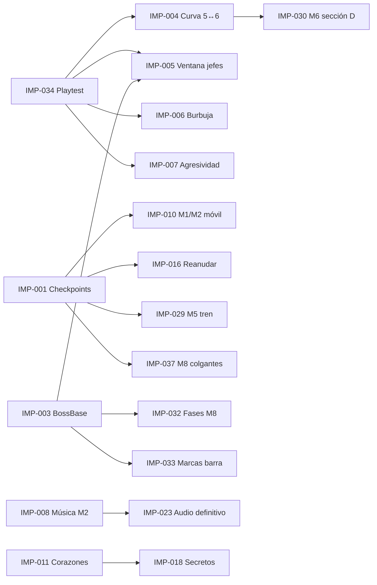

# Propuestas de mejora — Alice Dreams (Godot)

> Propuestas concretas derivadas de [`GAME_DESIGN_DOCUMENT.md`](GAME_DESIGN_DOCUMENT.md) y [`LEVEL_AUDIT.md`](LEVEL_AUDIT.md). **Ninguna está implementada.** Todas respetan la identidad del juego: plataformas 2D infantil, tono amable (los jefes “se duermen”, no mueren), tres armas de juguete, un nivel largo + una arena por mundo.
>
> **Reglas de lectura**
> - *Problema detectado* cita evidencia del repositorio o de las ejecuciones automáticas de esta auditoría. El piloto automático (`tests/autopilot.gd`) **no es un jugador humano**: corre, salta y dispara, pero no esquiva; sus fallos señalan puntos de riesgo, no prueban que un humano fallará.
> - Los niveles 2-8 se **generan** con `tools/worldN/worldN_level.py`; el Mundo 1 sale de `src/data/world1.js` vía `godot/tools/convert_phaser.mjs`. Cualquier cambio de diseño de nivel debe hacerse en el generador y regenerar el JSON (si se edita el JSON directamente se perderá en la próxima regeneración).
> - Recordatorio de numeración: **Mundo 5 = archivos `world6`** (Tren de Juguete); **Mundo 6 = archivos `world5`** (Sueños Cósmicos).
> - Archivos marcados **(nuevo, propuesto)** no existen todavía.

## Índice

| ID | Ámbito | Título | Prioridad | Complejidad |
|---|---|---|---|---|
| [IMP-001](#imp-001) | Todos los mundos | Un checkpoint por sección | Alta | Baja |
| [IMP-002](#imp-002) | Técnico / arte | Escalado entero *pixel-perfect* | Media | Baja |
| [IMP-003](#imp-003) | Jefes / técnico | Clase base común para los jefes | Media | Media |
| [IMP-004](#imp-004) | Progresión | Corregir la curva de dificultad tras el cambio 5↔6 | Media | Media |
| [IMP-005](#imp-005) | Jefes | Ventana de vulnerabilidad con significado | Media | Media |
| [IMP-006](#imp-006) | Combate | Equilibrar el Lanzaburbujas frente a enemigos resistentes | Media | Baja |
| [IMP-007](#imp-007) | Enemigos | Curva de agresividad por mundo | Media | Baja |
| [IMP-008](#imp-008) | Audio | Conectar la música existente del Mundo 2 | Alta | Baja |
| [IMP-009](#imp-009) | UI / técnico | Un solo catálogo de mundos | Baja | Baja |
| [IMP-010](#imp-010) | Mundos 1 y 2 | Obstáculos de timing sobre fosos sin checkpoint previo | Alta | Baja |
| [IMP-011](#imp-011) | Mundos 1-6 | Corazones recogibles | Media | Baja |
| [IMP-012](#imp-012) | Técnico | Avisar de animaciones inexistentes | Baja | Baja |
| [IMP-013](#imp-013) | Técnico / QA | Dividir la suite de pruebas | Baja | Media |
| [IMP-014](#imp-014) | Técnico | Registro de manejadores de contacto | Baja | Media |
| [IMP-015](#imp-015) | Técnico | Esquema de datos por mundo | Baja | Media |
| [IMP-016](#imp-016) | Experiencia | Reanudar en el último checkpoint tras cerrar | Media | Media |
| [IMP-017](#imp-017) | Controles | Soporte de mando | Alta | Baja |
| [IMP-018](#imp-018) | Exploración | Rutas secretas con recompensa tangible | Media | Media |
| [IMP-019](#imp-019) | Accesibilidad | Opción “correr siempre” | Media | Baja |
| [IMP-020](#imp-020) | Feedback | Respuesta al golpe más clara (Alice y jefes) | Media | Baja |
| [IMP-021](#imp-021) | Progresión | Registro “sin caídas” en lugar de *game over* | Baja | Baja |
| [IMP-022](#imp-022) | Narrativa | Introducción y transición entre mundos | Media | Media |
| [IMP-023](#imp-023) | Audio | Música y efectos definitivos | Media | Alta |
| [IMP-024](#imp-024) | Arte / menú | Islas definitivas del carrusel | Baja | Media |
| [IMP-025](#imp-025) | Mundo 1 | Sección E con desafío final | Media | Baja |
| [IMP-026](#imp-026) | Mundo 2 | Sección E “El Gran Lienzo” prácticamente vacía | Baja | Baja |
| [IMP-027](#imp-027) | Mundo 3 | Ovillo entre dos cuerdas sobre fosos | Alta | Baja |
| [IMP-028](#imp-028) | Mundo 4 | Variación enemiga ligada al agua | Baja | Media |
| [IMP-029](#imp-029) | Mundo 5 | Cruce en tren de la sección E (teselas 553-591) | Alta | Baja |
| [IMP-030](#imp-030) | Mundo 6 | Pico de densidad en la sección D | Media | Baja |
| [IMP-031](#imp-031) | Mundo 7 | Exceso de carteles tutoriales | Baja | Baja |
| [IMP-032](#imp-032) | Mundo 8 | Reintento por fase en el jefe final | Media | Media |
| [IMP-033](#imp-033) | Jefes | Marcas de fase en la barra del jefe | Baja | Baja |
| [IMP-034](#imp-034) | QA / proceso | Sesión de prueba jugada estructurada | Crítica | Baja |
| [IMP-035](#imp-035) | Mundo 5 | Sección C: viaje en tren con interacción | Baja | Media |
| [IMP-036](#imp-036) | UI / todos | Bocadillos de cartel recortados en el borde izquierdo | Alta | Baja |
| [IMP-037](#imp-037) | Mundo 8 | Plataformas colgantes antes del primer checkpoint | Alta | Baja |
| [IMP-038](#imp-038) | Arte | Diferenciar el terreno entre mundos | Baja | Media |
| [IMP-039](#imp-039) | Accesibilidad | Distinguir estrellas recogibles de las decorativas | Media | Baja |
| [IMP-040](#imp-040) | QA | Piloto automático como prueba de regresión | Alta | Baja |

---

## A. Transversales (afectan a todos los mundos)

### IMP-001
**Un checkpoint por sección**
- **Mundo o nivel:** Mundos 1-8 (niveles, no arenas).
- **Problema detectado:** cada nivel mide 7 600-10 500 px y tiene sólo 2 checkpoints (3 en el Mundo 8), siempre en las secciones B y D (C en el Mundo 3). Las secciones A, C y E no tienen ninguno. Caer al vacío o desmayarse devuelve al último checkpoint (`level.gd → handle_fall`, `respawn`). Tramos máximos sin checkpoint: Mundo 5 4 480 px (teselas 118→398), Mundo 8 4 400 px (150→425), Mundo 7 4 208 px, Mundo 6 4 096 px. El piloto automático en el Mundo 1 cayó 49 veces en la tesela 248 y en cada caída volvió a la tesela 138 (≈1 760 px atrás).
- **Mejora propuesta:** añadir una bandera al inicio de cada sección (la entrada de C y de E como mínimo) y una justo antes de cada obstáculo de *timing* largo (plataforma móvil sobre foso, cruce en tren, cuerdas). Mantener la regla actual (al activar, vida completa).
- **Impacto esperado:** fallar cuesta segundos, no un minuto de recorrido repetido; esencial para la edad objetivo (7 años, según `WORLD7_REPORT.md`).
- **Complejidad:** Baja. **Prioridad:** Alta.
- **Archivos involucrados:** `src/data/world1.js` (+ `godot/tools/convert_phaser.mjs`) y `godot/data/worlds/world1.json`; `tools/world{2..8}/world{2..8}_level.py` y los `godot/data/world{2..8}/world{2..8}.json` generados.
- **Dependencias:** ninguna (el sistema admite N checkpoints: `checkpoint_manager.gd`).
- **Criterios de aceptación:** cada sección A-E de cada nivel contiene ≥1 checkpoint o empieza a ≤ 320 px de uno; ningún tramo sin checkpoint supera 2 500 px; las pruebas `test_fall_respawn_checkpoint` y `test_wN_*` siguen pasando.
- **Estado: hecho.** Checkpoints nuevos (teselas) en suelo plano, lejos de peligros y a ≥ 6 teselas de donde aparece un enemigo:

  | Mundo | Antes | Ahora | Tramo más largo |
  |---|---|---|---|
  | 1 | 138, 367 | 138, **229**, 367, **401** | 3 664 → 2 208 px |
  | 2 | 146, 357 | **125**, **211**, 357, **458** | 3 376 → 2 336 px |
  | 3 | 109, 322 | 109, **214**, 322, **409**, **485** | 3 888 → 1 728 px |
  | 4 | 173, 352 | **111**, 173, **230**, 352, **500** | 3 408 → 2 368 px |
  | 5 (`world6`) | 118, 398 | 118, **254**, 398, **548** | 4 480 → 2 400 px |
  | 6 (`world5`) | 163, 419 | **126**, 163, **265**, 419, **540** | 4 096 → 2 464 px |
  | 7 | 205, 468 | **127**, 205, **301**, **410**, 468, **564** | 4 208 → 1 968 px |
  | 8 | 116, 150, 425, 610 | 116, 150, **241**, **336**, 425, **518**, 610 | 4 400 → 1 792 px |

  Antes de obstáculos de *timing*: Mundo 1 tesela 229 (nube móvil 245-255), Mundo 2 tesela 125 (puente dibujado 132-140; sustituye al de la 146, que quedaba **después**), Mundo 5 teselas 254 y 548 (subida a los trenes de C y E), Mundo 8 tesela 116 (IMP-037). Prueba nueva `test_checkpoint_spacing` (los 8 niveles: secciones, tramos y suelo). Pendiente de afinar con la prueba jugada (IMP-034).

### IMP-002
**Escalado entero *pixel-perfect***
- **Mundo o nivel:** global.
- **Problema detectado:** `project.godot` define `window/stretch/mode="viewport"` pero no `window/stretch/scale_mode`, que por defecto es `fractional`. En pantallas 1366×768 o 1600×900 el factor no es entero y las columnas de píxeles tienen anchos distintos (efecto “píxeles bailando” en el *scroll*).
- **Mejora propuesta:** `window/stretch/scale_mode="integer"` (con bandas) y comprobar el HUD y el menú a 1×, 2×, 3× y 4×.
- **Impacto esperado:** píxeles uniformes; coherencia con la estética retro.
- **Complejidad:** Baja. **Prioridad:** Media.
- **Archivos involucrados:** `godot/project.godot`.
- **Dependencias:** ninguna.
- **Criterios de aceptación:** a 1366×768 la imagen se muestra a 2× con bandas, sin columnas de ancho desigual (captura con `tests/Capture.tscn`); menú y HUD sin recortes.
- **Estado: hecho (decisión del autor: entero con bandas).** `window/stretch/scale_mode="integer"` en `project.godot`; la resolución lógica (480×270) no cambia, así que HUD, menús y controles táctiles se dibujan igual. Prueba `test_integer_scaling`. `tests/Capture.tscn` guarda la imagen lógica, no la ventana: las bandas a 1366×768 quedan por comprobar en una pantalla real.

### IMP-003
**Clase base común para los jefes**
- **Mundo o nivel:** todas las arenas.
- **Problema detectado:** ocho scripts (`scripts/entities/nubarron.gd` 492 líneas, `garabato.gd` 552, `rey_sieston.gd` 190, `rey_patoburbuja.gd` 384, `locomostro.gd` 487, `luna_estelar.gd` 485, `don_chupeton.gd` 489, `rey_pesadelo.gd` 535) repiten la misma interfaz (`setup`, `intro`, `hit_by`, `defeated_at`, `is_defeated`, `set_body_enabled`, `invulnerable`) y la misma lógica de daño, destello, umbrales de fase 65 %/30 % y `PHASE_CHANGE`, sin `class_name` base. `boss_arena.gd` depende de esa interfaz implícita.
- **Mejora propuesta:** crear `BossBase` (`extends CharacterBody2D`) con `hit_by()`, umbrales de fase configurables, destello, `REST` y señal `defeated_at`; cada jefe sólo define `PHASES` y sus estados de ataque. Migrar de uno en uno, empezando por Nubarrón, con las pruebas actuales como red de seguridad.
- **Impacto esperado:** IMP-005 e IMP-033 se implementan una vez; menos riesgo de divergencias.
- **Complejidad:** Media. **Prioridad:** Media.
- **Archivos involucrados:** `godot/scripts/entities/boss_base.gd` **(nuevo, propuesto)**; los 8 scripts de jefe; `godot/scripts/levels/boss_arena.gd`; `godot/scripts/levels/world8_boss_arena.gd`.
- **Dependencias:** suite `tests/Tests.tscn`.
- **Criterios de aceptación:** los 8 jefes heredan de `BossBase`; `hit_by` existe sólo en la base (o la sobrescribe con `super()`); 0 fallos en `Tests.tscn` (las 131 pruebas actuales).
- **Estado: hecho.** `godot/scripts/entities/boss_base.gd` (`extends Area2D`, como los jefes, no `CharacterBody2D`): señal `defeated_at`, estado compartido, `player`/`now`, `is_defeated`, `phase_data`, `set_body_enabled`, `intro`, `facing`, `after`, `hit_by` y `take_damage` con los umbrales de fase en `PHASE_THRESHOLDS` (65 %/30 %). Cada jefe sólo define `MAX_HP`, `PHASES` y sus estados; la base lee esas constantes. Puntos de extensión: `phase_change_state` (`HURT` en el Rey Pesadelo), `on_hurt()` (gesto de dolor en el descanso de Locomostro y Don Chupetón, y aturdido en el Rey Pesadelo) e `impact_effects` (chispa o pintura en Nubarrón y Garabato). El Rey Pesadelo conserva su `is_defeated` (también TRANSFORMING y CAT) y amplía `set_body_enabled` con `super()`. Prueba `test_boss_base`. Sin cambios de comportamiento: todas las pruebas de jefes siguen en verde.

### IMP-004
**Corregir la curva de dificultad tras el cambio 5↔6**
- **Mundo o nivel:** Mundos 5 (archivos `world6`) y 6 (archivos `world5`).
- **Problema detectado:** el commit `708db79` intercambió el orden de juego, pero no los contenidos. Resultado medido en los datos:

  | Mundo | Densidad de enemigos (por 1000 px) | PV del jefe |
  |---|---|---|
  | 4 | 2,4 | 50 |
  | **5** (Tren) | **2,0** | **60** |
  | **6** (Cósmico) | **3,1** (la más alta del juego) | **50** |
  | 7 | 1,9 | 65 |
  | 8 | 2,4 | 80 |

  El Mundo 6 es el más denso del juego (más que el final) y su jefe tiene menos vida que el del mundo anterior. Matiz: el piloto automático completó el Mundo 6 **sin invulnerabilidad con sólo 3 golpes** (77 s), mientras que en el Mundo 5 se atasca en el cruce en tren (IMP-029). La densidad no se traduce directamente en dificultad (los enemigos cósmicos atacan cada 1,7-2,0 s); el desajuste es sobre todo de **ritmo y de PV de jefe**.
- **Mejora propuesta:** (a) reducir la densidad del Mundo 6 a ≈2,4 (ver IMP-030); (b) subir a Luna Estelar a 60-62 PV o bajar Locomostro a 55; (c) dejar documentada una tabla objetivo de densidad y PV por mundo en este repositorio.
- **Impacto esperado:** progresión sin picos ni retrocesos.
- **Complejidad:** Media. **Prioridad:** Media (subir a Alta si la prueba jugada IMP-034 confirma el pico).
- **Archivos involucrados:** `tools/world5/world5_level.py`, `godot/data/world5/world5.json`, `godot/scripts/entities/luna_estelar.gd` (`MAX_HP`) o `godot/scripts/entities/locomostro.gd`.
- **Dependencias:** IMP-034 para validar con personas.
- **Criterios de aceptación:** densidad y PV de jefe no decrecen de un mundo al siguiente salvo decisión documentada; `test_w5_boss` y `test_w6_boss` adaptados y en verde.

### IMP-005
**Ventana de vulnerabilidad con significado**
- **Mundo o nivel:** las 8 arenas.
- **Problema detectado:** todos los jefes describen un descanso (`REST` / `STUNNED`) como “ventana para golpearle”, pero en `hit_by()` sólo son invulnerables durante INTRO, cambio de fase y derrota (p. ej. `nubarron.gd` L461-490). Con el Tirachinas (3 de daño/650 ms) Nubarrón cae en ≈9 s de impactos y el Rey Pesadelo en ≈17 s, ataque o no ataque. El aviso + descanso, bien diseñados, no cambian la estrategia óptima: disparar sin parar.
- **Mejora propuesta:** daño ×2 durante `REST`/`STUNNED` y ×0,5 fuera (mínimo 1), con chispa dorada distinta al acertar en la ventana. Así se premia leer el patrón sin bloquear a quien sólo dispara.
- **Impacto esperado:** combates con ritmo “esquivar → castigar”, coherentes con lo que ya anuncian los avisos.
- **Complejidad:** Media (Baja tras IMP-003). **Prioridad:** Media.
- **Archivos involucrados:** los 8 scripts de jefe o `boss_base.gd` (IMP-003).
- **Dependencias:** IMP-003 (recomendado); IMP-034 para ajustar multiplicadores.
- **Criterios de aceptación:** prueba automática que compare el daño de un mismo proyectil en `REST` y en ataque; tiempo de combate mínimo (disparo continuo perfecto) ≥ 1,3× el actual.

### IMP-006
**Equilibrar el Lanzaburbujas frente a enemigos resistentes**
- **Mundo o nivel:** todos (armas iniciales desde el Mundo 2).
- **Problema detectado:** `enemy.gd → hit_by`: una burbuja atrapa a cualquier enemigo y un segundo impacto (o tocarlo) lo convierte en estrella, sin mirar su vida. La vida de Gomilito (4) o Bloquito Sombra (4) sólo importa contra Pintura y Tirachinas. Sólo el Bloquito Sombra tiene defensa (barrera, `bloquito_sombra.gd`). Las tres armas pierden identidad: el Lanzaburbujas es a la vez el más rápido (230 ms) y el más eficaz.
- **Mejora propuesta:** los enemigos con `hp ≥ 4` necesitan dos burbujas para quedar atrapados (la primera los “envuelve a medias”, con indicador) **o** su tiempo de trampa baja de 3,5 s a 1,8 s. Mantener que un enemigo atrapado se convierta en estrella (es la seña de identidad del arma).
- **Impacto esperado:** razones para cambiar de arma; los enemigos “grandes” se sienten grandes.
- **Complejidad:** Baja. **Prioridad:** Media.
- **Archivos involucrados:** `godot/scripts/entities/enemy.gd`, `godot/scripts/entities/enemy_def.gd`, `godot/data/world7/enemies.json`, `godot/data/world8/enemies.json`, `godot/tools/build_resources.gd` (si se añade un campo nuevo al `EnemyDef`).
- **Dependencias:** ninguna.
- **Criterios de aceptación:** prueba: 1 burbuja atrapa a un Arañitas y no a un Gomilito; `test_bubble_traps_and_star` y `test_w7_weapons_vs_enemies` actualizados.

### IMP-007
**Curva de agresividad por mundo**
- **Mundo o nivel:** todos.
- **Problema detectado:** los enfriamientos de ataque **crecen** con el avance: Mundo 1 900-1 700 ms; Mundo 7 1 400-2 300 ms; Mundo 8 2 200-2 600 ms (`data/**/enemies.json`). La vida se mantiene en 2-4. Los enemigos finales atacan con menos frecuencia que los del primer mundo; la dificultad recae casi sólo en el terreno.
- **Mejora propuesta:** tabla objetivo de `attackCooldown` y `reactionTime` decreciente suave (p. ej. −5 % por mundo) partiendo de los valores actuales del Mundo 2-3, manteniendo siempre el aviso (`telegraph`) ≥ 400 ms.
- **Impacto esperado:** sensación de progresión en el combate sin aumentar la crueldad.
- **Complejidad:** Baja. **Prioridad:** Media.
- **Archivos involucrados:** `godot/data/world{2..8}/enemies.json`, `godot/resources/**/enemies/*.tres` (regenerados por `godot/tools/build_resources.gd`).
- **Dependencias:** IMP-034.
- **Criterios de aceptación:** mediana de `attackCooldown` no creciente entre mundos consecutivos; ningún aviso por debajo de 400 ms.

### IMP-008
**Conectar la música existente del Mundo 2**
- **Mundo o nivel:** Mundo 2 y arena de Garabato.
- **Problema detectado:** `godot/resources/audio/mundo_2.mp3` y `jefe_mundo_2.mp3` existen (con `.import`) pero ninguna ruta los usa: `AudioConfig.MUSIC_FILES["world2"]` y `["garabato"]` están vacíos y `OPTIONAL_MUSIC` busca `world2_theme.ogg` y `garabato_boss.ogg`. El Mundo 2 suena con la síntesis provisional.
- **Mejora propuesta:** asignar `"world2": "res://resources/audio/mundo_2.mp3"` y `"garabato": "res://resources/audio/jefe_mundo_2.mp3"` en `MUSIC_FILES` (mismo patrón que el Mundo 1) y activar el bucle en su importación: hoy ambos `.import` tienen `loop=false`, mientras que `mundo_1.mp3.import` tiene `loop=true`.
- **Impacto esperado:** el segundo mundo gana su música real con un cambio de dos líneas.
- **Complejidad:** Baja. **Prioridad:** Alta.
- **Archivos involucrados:** `godot/scripts/core/audio_config.gd`, `godot/resources/audio/mundo_2.mp3.import`, `godot/resources/audio/jefe_mundo_2.mp3.import`.
- **Dependencias:** confirmar con el autor que esas pistas son las definitivas del Mundo 2.
- **Criterios de aceptación:** `AudioManager._music_streams["world2"]` es un `AudioStreamMP3` al arrancar; la pista se repite en bucle; `CheckAll` sin fallos.
- **Estado: hecho.** Las dos pistas están en `MUSIC_FILES` con `loop=true` en su importación; `test_menu_keyboard` comprueba ahora también `world2` y `garabato`. Falta confirmar de oído que el bucle no corta.

### IMP-009
**Un solo catálogo de mundos**
- **Mundo o nivel:** menú, victoria.
- **Problema detectado:** nombres cortos duplicados y distintos: `WorldRegistry.WORLDS[3].short = "Reino de las Burbujas"` frente a `WorldData.CATALOG = "Océano de Burbujas"`.
- **Mejora propuesta:** que `WorldData.catalog()` lea nombres de `WorldRegistry` y conserve sólo los recortes de ilustración.
- **Impacto esperado:** un único punto de verdad; nombres coherentes.
- **Complejidad:** Baja. **Prioridad:** Baja.
- **Archivos involucrados:** `godot/scripts/ui/world_data.gd`, `godot/scripts/levels/world_registry.gd`.
- **Dependencias:** ninguna.
- **Criterios de aceptación:** ningún nombre de mundo está escrito en `world_data.gd`; `test_world_carousel` pasa.
- **Estado: hecho.** `WorldData.catalog()` toma el nombre del nombre corto (`short`) de `WorldRegistry`; `world_data.gd` sólo guarda los recortes de ilustración. La única discrepancia era el Mundo 4: el nombre corto pasa a «Océano de Burbujas», como en el carrusel y el mapa (también lo usa el Diario de Sueños).

### IMP-011
**Corazones recogibles en los Mundos 1-6**
- **Mundo o nivel:** Mundos 1-6.
- **Problema detectado:** el objeto corazón (`scripts/objects/heart_pickup.gd`) sólo aparece en los Mundos 7 (4) y 8 (6). En 1-6 la única curación es activar uno de los 2 checkpoints.
- **Mejora propuesta:** 2-3 corazones por nivel, colocados después de los tramos con más enemigos y en rutas opcionales (refuerza IMP-018). Requiere que `World1-6` acepten el contacto `heart` (hoy se gestiona en `world7.gd` / `world8.gd` → mover a `level.gd`).
- **Impacto esperado:** colchón de error para la edad objetivo; razón para explorar.
- **Complejidad:** Baja. **Prioridad:** Media.
- **Archivos involucrados:** `godot/scripts/levels/level.gd`, `godot/scripts/levels/world7.gd`, `godot/scripts/levels/world8.gd`, generadores `tools/world{2..6}/*_level.py`, `src/data/world1.js`.
- **Dependencias:** ninguna.
- **Criterios de aceptación:** cada nivel 1-6 tiene ≥2 corazones; recoger uno con vida completa no lo consume (comportamiento actual de `heart_pickup.gd → collect`, que debe conservarse).

### IMP-012
**Avisar de animaciones inexistentes**
- **Mundo o nivel:** técnico.
- **Problema detectado:** `scripts/core/anim.gd → play()` vuelve en silencio si la animación no existe. Los enemigos del Mundo 8 llaman `defeat` en lugar de `defeated` y se corrige caso por caso (`fantasmita.gd` L42, `murcibola.gd` L38, `bloquito_sombra.gd` L25). Un error de nombre pasaría desapercibido.
- **Mejora propuesta:** `push_warning` una sola vez por (hoja, animación) cuando `OS.is_debug_build()`.
- **Complejidad:** Baja. **Prioridad:** Baja.
- **Archivos involucrados:** `godot/scripts/core/anim.gd`.
- **Dependencias:** ninguna.
- **Criterios de aceptación:** la suite completa no produce ningún aviso nuevo (o se corrigen los que aparezcan).
- **Estado: hecho.** `Anim.play` y `Anim.show_frame` avisan una vez por escena y animación (`push_warning`, sólo en depuración). La suite completa sólo produjo un aviso: las gomitas (`GomilitoMini`) heredan el ataque del Gomilito y pedían `attack`, que su hoja no tiene (un fotograma por color); ahora se comprueba antes en `gomilito.gd`.

### IMP-013
**Dividir la suite de pruebas**
- **Problema detectado:** `godot/tests/run_tests.gd` tiene 4 116 líneas y 131 pruebas en un único archivo.
- **Mejora propuesta:** un archivo por mundo (`tests/world1_tests.gd`… **nuevos, propuestos**) y uno común, con el mismo `Tests.tscn` como lanzador; argumento opcional `-- only=w7`.
- **Complejidad:** Media. **Prioridad:** Baja.
- **Archivos involucrados:** `godot/tests/run_tests.gd`, `godot/tests/Tests.tscn`.
- **Criterios de aceptación:** mismas 1 488 comprobaciones en verde; ejecución filtrada por mundo.
- **Estado: hecho.** `tests/test_base.gd` (utilidades y recuento compartido), `tests/suites/` con `common_tests.gd`, `world2_tests.gd` … `world8_tests.gd` y `narrative_tests.gd` (cada uno con su lista `TESTS` y sus ayudantes; los compartidos están en la base) y `run_tests.gd` como lanzador (59 líneas). Filtro `-- only=w7` por grupo o `-- only=test_x` por nombre. División hecha con un script: las 187 funciones se conservan con el cuerpo idéntico y la suite da el mismo número de comprobaciones que antes de dividirla.

### IMP-014
**Registro de manejadores de contacto**
- **Problema detectado:** `level.gd → _process_overlaps` (L188-238) tiene un `match` con casos de mundos concretos (pintura, agua, géiser, rodillo, botón mágico…) y cada mundo añade los suyos en `on_custom_overlap`.
- **Mejora propuesta:** que cada objeto exponga `on_player_overlap(level, player, delta)` y el bucle sólo lo llame; conservar los casos especiales que necesitan agregación por fotograma (pintura, agua).
- **Complejidad:** Media. **Prioridad:** Baja.
- **Archivos involucrados:** `godot/scripts/levels/level.gd`, `godot/scripts/objects/*.gd`, `godot/scripts/levels/world{5..8}.gd`.
- **Dependencias:** IMP-013 recomendable.
- **Criterios de aceptación:** añadir un objeto nuevo no requiere tocar `level.gd`; 0 fallos en la suite.

### IMP-015
**Esquema de datos por mundo**
- **Problema detectado:** `world8.json` declara también `rulers`, `paints`, `rivers`, `magicCrayons`, `yarnRollers`, `sleepClouds`, `magicButtons`… (vacías); `LevelBuilder.build()` crece con cada mundo.
- **Mejora propuesta:** el builder trata cada clave como opcional (`data.get(k, [])`) y los generadores sólo escriben las claves usadas; dividir `build()` en un constructor por familia de objetos.
- **Complejidad:** Media. **Prioridad:** Baja.
- **Archivos involucrados:** `godot/scripts/levels/level_builder.gd`, `tools/world*/world*_level.py`.
- **Criterios de aceptación:** los JSON regenerados sólo contienen claves no vacías; todas las pruebas pasan.

### IMP-016
**Reanudar en el último checkpoint tras cerrar el juego**
- **Problema detectado:** `SaveManager` sólo guarda mundos completados; el checkpoint vive en `GameState` (memoria). Cerrar el juego a mitad de un nivel de 90-110 s (tiempos del piloto) obliga a empezarlo de nuevo.
- **Mejora propuesta:** guardar `{world, scene, checkpoint, stars recogidas}` al activar un checkpoint y ofrecer “Continuar” en la tarjeta del mundo.
- **Complejidad:** Media. **Prioridad:** Media.
- **Archivos involucrados:** `godot/scripts/core/save_manager.gd`, `godot/scripts/systems/checkpoint_manager.gd`, `godot/scripts/levels/world_registry.gd`, `godot/scripts/ui/world_card.gd`.
- **Dependencias:** IMP-001 (más checkpoints hacen la función más útil).
- **Criterios de aceptación:** cerrar y reabrir tras activar un checkpoint ofrece reanudar allí; un guardado sin el campo nuevo carga sin errores (`test_save_manager`).

### IMP-017
**Soporte de mando**
- **Problema detectado:** el Input Map (`project.godot [input]`) sólo tiene eventos de teclado.
- **Mejora propuesta:** añadir `InputEventJoypadButton`/`InputEventJoypadMotion` a todas las acciones (cruceta/stick, A saltar, X disparar, Y arma, gatillo correr, Start pausa).
- **Complejidad:** Baja. **Prioridad:** Alta (público infantil: el mando es más cómodo que Shift+Espacio+J).
- **Archivos involucrados:** `godot/project.godot`. `godot/scripts/systems/input_controller.gd` ya lee acciones (`Input.is_action_pressed`), no teclas, así que no necesita cambios para el mando.
- **Criterios de aceptación:** recorrido completo del Mundo 1 con un mando XInput; menús navegables con el mando.
- **Estado: hecho (pendiente de probar con un mando físico).** Eventos de mando en las 11 acciones de `project.godot` (cruceta/stick, A, X, Y, gatillos, Start). En los menús el stick cuenta como una pulsación al salir de la zona central (`MenuList.is_stick_repeat`), así una inclinación no recorre varias opciones; lo usan la lista de botones, el carrusel y el Diario de Sueños, y la celebración de rescates bloquea también los eventos del mando. Prueba `test_gamepad` con eventos simulados (menú, andar, correr, saltar, pausa). No se ha probado con un mando real.

### IMP-018
**Rutas secretas con recompensa tangible**
- **Problema detectado:** la exploración se recompensa con estrellas (138-298 por nivel, abundantes y por tanto poco valiosas) y coleccionables que dan, como mucho, **una** estrella extra. Los Mundos 1-2 no tienen coleccionables de exploración más allá de los crayones (M2).
- **Mejora propuesta:** una ruta alta o escondida por sección C/D con corazón (IMP-011) o un “fragmento de sueño” que, al reunir los de todos los mundos, desbloquee un extra en el menú (p. ej. galería de jefes con sus sprites existentes).
- **Complejidad:** Media. **Prioridad:** Media.
- **Archivos involucrados:** generadores `tools/world*/*_level.py`, `src/data/world1.js`, `godot/scripts/ui/menu.gd`, `godot/scripts/core/save_manager.gd`.
- **Dependencias:** IMP-011.
- **Criterios de aceptación:** cada mundo tiene ≥1 secreto señalado por una pista visual (no por cartel); el extra se desbloquea y se guarda.

### IMP-019
**Opción “correr siempre”**
- **Problema detectado:** correr exige mantener Shift además de saltar (Espacio) y disparar (J), y varios huecos se diseñaron con la carrera (cartel del Mundo 1, tesela 26: “Mantén SHIFT para correr y saltar más lejos”).
- **Mejora propuesta:** ajuste en pausa y menú “Correr: mantener / siempre”; con “siempre”, Shift camina.
- **Complejidad:** Baja. **Prioridad:** Media.
- **Archivos involucrados:** `godot/scripts/systems/input_controller.gd`, `godot/scripts/ui/pause_menu.gd`, `godot/scripts/ui/menu.gd`, `godot/scripts/core/save_manager.gd` (`settings`).
- **Criterios de aceptación:** con la opción activa la velocidad horizontal sin Shift es `runSpeed` (150 px/s); el ajuste persiste.

### IMP-020
**Respuesta al golpe más clara**
- **Problema detectado:** al recibir daño hay parpadeo, retroceso, sonido y una sacudida de 120 ms (`player.gd → hurt`); no hay pausa de impacto (*hit-stop*) ni destello. Al golpear a un jefe hay destello blanco de 60 ms; la barra del jefe no muestra el daño reciente.
- **Mejora propuesta:** *hit-stop* de 50-70 ms al recibir daño y al acertar a un jefe; destello blanco de Alice reutilizando `resources/effects/flash.gdshader`; tramo “fantasma” en la barra de vida del jefe que se vacía con retraso.
- **Complejidad:** Baja. **Prioridad:** Media.
- **Archivos involucrados:** `godot/scripts/entities/player.gd`, `godot/scripts/levels/level.gd` (pausa de física breve con su reloj `now`), `godot/scripts/ui/hud.gd`, `godot/resources/effects/flash.gdshader`.
- **Criterios de aceptación:** el reloj `Level.now` no avanza durante el *hit-stop*; la duración es configurable y puede ponerse a 0.

### IMP-021
**Registro “sin caídas” en lugar de *game over***
- **Problema detectado:** no hay vidas ni *game over*; fallar sólo devuelve al checkpoint. Es coherente con el público, pero no hay ningún incentivo para jugar limpio.
- **Mejora propuesta:** **no** añadir vidas. Registrar caídas y golpes en la partida y mostrar en Victoria un sello “¡Sin caídas!” (y guardarlo como `bestTime`).
- **Complejidad:** Baja. **Prioridad:** Baja.
- **Archivos involucrados:** `godot/scripts/core/game_state.gd`, `godot/scripts/levels/level.gd`, `godot/scripts/ui/victory.gd`, `godot/scripts/core/save_manager.gd`.
- **Criterios de aceptación:** el sello aparece sólo si no hubo caídas en nivel ni arena; el guardado antiguo sigue cargando.

### IMP-022
**Introducción y transición entre mundos**
- **Problema detectado:** la historia sólo se cuenta al final (Mundo 8). No hay escena inicial ni texto que explique por qué Alice viaja por los reinos.
- **Mejora propuesta:** una viñeta breve antes del Mundo 1 reutilizando `resources/world8/cinematics/bedroom.png` (Alice se duerme) y una línea de texto en la pantalla de victoria que anticipe el siguiente reino. Saltable.
- **Complejidad:** Media. **Prioridad:** Media.
- **Archivos involucrados:** `godot/scenes/cinematics/Intro.tscn` y `godot/scripts/cinematics/intro.gd` **(nuevos, propuestos)**, `godot/scripts/core/router.gd`, `godot/scripts/ui/victory.gd`, `godot/scripts/levels/world_registry.gd`.
- **Criterios de aceptación:** primera partida muestra la intro una vez (marcada en el guardado); se puede saltar con cualquier acción.

### IMP-023
**Música y efectos definitivos**
- **Problema detectado:** 56 efectos y 24 de 27 pistas son síntesis provisional (`synth.gd`); `OPTIONAL_MUSIC` espera 24 `.ogg` que no existen.
- **Mejora propuesta:** producir o licenciar las pistas siguiendo los nombres ya previstos en `OPTIONAL_MUSIC`; priorizar efectos de alta frecuencia de uso (`jump`, `hurt`, `star`, `enemy_hit`, `boss_hit`).
- **Complejidad:** Alta (producción de contenido). **Prioridad:** Media.
- **Archivos involucrados:** `godot/resources/audio/*` **(nuevos)**, `godot/scripts/core/audio_config.gd`.
- **Dependencias:** IMP-008.
- **Criterios de aceptación:** ningún evento de `Synth.SFX` usado en el Mundo 1 suena sintetizado; todas las pistas se repiten sin cortes audibles.

### IMP-024
**Islas definitivas del carrusel**
- **Problema detectado:** `world_data.gd` documenta que ninguna isla definitiva existe (`res://resources/menu/islands/`) y que se recortan de `world_map_bg.png` con máscara; `menu.gd` difumina las islas pintadas en el fondo porque falta `menu_bg_clean.png`.
- **Mejora propuesta:** exportar las 8 islas con transparencia y el fondo limpio desde las ilustraciones de `imagenes/` con el pipeline `tools/menu/prepare_menu_assets.py`.
- **Complejidad:** Media. **Prioridad:** Baja.
- **Archivos involucrados:** `tools/menu/prepare_menu_assets.py`, `godot/resources/menu/islands/world_N.png` y `godot/resources/menu/menu_bg_clean.png` **(nuevos)**.
- **Criterios de aceptación:** el menú ya no aplica velo ni máscara ovalada; `test_menu_art` pasa.

### IMP-033
**Marcas de fase en la barra del jefe**
- **Problema detectado:** la barra (`hud.gd` L130-144) es un rectángulo lavanda sin marcas; todas las fases cambian al 65 % y 30 %.
- **Mejora propuesta:** dos muescas en 65 % y 30 % y cambio de color de la barra por fase.
- **Complejidad:** Baja. **Prioridad:** Baja.
- **Archivos involucrados:** `godot/scripts/ui/hud.gd`; umbrales desde `BossBase` (IMP-003) o constantes compartidas.
- **Criterios de aceptación:** las muescas coinciden con los umbrales reales de cada jefe.
- **Estado: hecho.** El color ya cambiaba por fase; ahora hay dos muescas claras en la barra. Los umbrales viven en `C.BOSS_PHASE_THRESHOLDS`, que usan a la vez `BossBase` y el HUD (sin que el HUD dependa del script de los jefes); `test_boss_base` comprueba que coinciden.

### IMP-034
**Sesión de prueba jugada estructurada**
- **Problema detectado:** todos los informes (`MIGRATION_REPORT.md` §4, `WORLD2_REPORT.md` §10, `WORLD7_REPORT.md`, `WORLD8_REPORT.md`) reconocen que nadie ha jugado los mundos a mano; esta auditoría tampoco pudo. El balance actual se apoya en un piloto que no esquiva.
- **Mejora propuesta:** protocolo de prueba con 2-3 jugadores (al menos uno de la edad objetivo): un mundo por sesión, registro de muertes por sección (añadir un *log* opcional `user://playtest.csv` con sección, tipo de fallo y tiempo), observación de dónde se leen o no los carteles y avisos.
- **Complejidad:** Baja. **Prioridad:** **Crítica** (todas las propuestas de balance dependen de ella).
- **Archivos involucrados:** `godot/scripts/levels/level.gd` (registro opcional), `docs/PLAYTEST_LOG.md` **(nuevo, propuesto)**.
- **Criterios de aceptación:** existe un registro por mundo con caídas/golpes por sección de al menos dos jugadores; las propuestas IMP-004/005/006/007 se ajustan con esos datos.
- **Estado: herramientas listas; faltan las sesiones.** Registro opcional con `-- --playtest` (`godot/scripts/systems/playtest_log.gd` → `user://playtest.csv`: inicio, golpe, caída, desmayo, sección, checkpoint, puerta y jefe vencido, con mundo, sección, tesela, tiempo y vida); resumen con `python tools/playtest_summary.py`; protocolo y plantilla en [`PLAYTEST_LOG.md`](PLAYTEST_LOG.md). Prueba `test_playtest_log`.

---

## B. Por mundo

### IMP-010
**Obstáculos de timing sobre fosos sin checkpoint previo — Mundos 1 y 2**
- **Mundo o nivel:** Mundo 1, sección C (Puentes del arcoíris); Mundo 2, secciones B (Jardín de crayones) y C (Río de pintura).
- **Problema detectado:** en el Mundo 1 el foso de 11 teselas (245-255) sólo se cruza con una nube móvil (`movers`: x 247, dx 7, 2 600 ms). En el Mundo 2 el foso de 30 teselas (219-248) termina en un libro móvil (`book_blue`, x 244, dx 3, 1 600 ms) sobre un río de pintura. El piloto automático **invulnerable** cayó en x≈3 977 49 veces (Mundo 1) y 16 (Mundo 2); en el Mundo 2 sin invulnerabilidad no pasó de la tesela 261 en 200 s (116 caídas, 80 de ellas aquí). Cada caída devuelve al checkpoint de la tesela 138 / 146.
  Segundo punto del Mundo 2: el puente dibujado de la sección B (`rulers` x 132, 9 teselas, ciclo 2 600 ms visible / 1 600 ms oculto) sobre un foso, con el checkpoint **justo después** (tesela 146): 32 caídas del piloto en la tesela 140 (con y sin invulnerabilidad), cada una de vuelta al inicio del nivel.
- **Mejora propuesta:** (1) checkpoint justo antes de cada foso (IMP-001); en el Mundo 2 basta con adelantar la bandera de la tesela 146 a ≈128; (2) en el Mundo 1, una nube fija pequeña a mitad de recorrido como “escalón de rescate” o alargar el recorrido del *mover* para que su tiempo de espera en cada extremo sea legible; (3) en el Mundo 2, añadir el patrón de “aviso” ya usado en otros objetos (parpadeo antes de invertir el sentido).
- **Impacto esperado:** el primer obstáculo de *timing* de cada mundo enseña en lugar de castigar.
- **Complejidad:** Baja. **Prioridad:** Alta.
- **Archivos involucrados:** `src/data/world1.js` → `godot/data/worlds/world1.json`; `tools/world2/world2_level.py` → `godot/data/world2/world2.json`; opcional `godot/scripts/objects/moving_platform.gd` para el aviso.
- **Dependencias:** IMP-001.
- **Criterios de aceptación:** el piloto invulnerable cruza el foso con ≤3 caídas en ambos mundos; una persona de la edad objetivo lo cruza en ≤3 intentos (IMP-034).
- **Estado: punto (1) hecho con IMP-001** (Mundo 1: checkpoint en la tesela 229; Mundo 2: el de la 146 pasa a la 125, antes del puente dibujado). Con el recuento de caídas corregido, el piloto invulnerable cae **1 vez** en todo el Mundo 1 y 1 en todo el Mundo 2 (las 49 y 16 de la auditoría eran el recuento inflado): primer criterio cumplido. Los puntos (2) y (3) (escalón de rescate y aviso antes de invertir el sentido) quedan a la espera de la prueba jugada.

### IMP-025
**Mundo 1 — Sección E con desafío final**
- **Problema detectado:** la sección E (teselas 406-475, “Castillo de Nubarrón”) sólo tiene 3 enemigos y 8 estrellas; ningún objeto de mecánica. Las mecánicas enseñadas en B-D (vapor, corriente, cojín, nube elástica) no se combinan antes del jefe.
- **Mejora propuesta:** un tramo corto que combine dos mecánicas ya enseñadas (p. ej. corriente de aire + nube de vapor) sin enemigos, como “examen” antes del castillo, con checkpoint a la entrada (IMP-001).
- **Complejidad:** Baja. **Prioridad:** Media.
- **Archivos involucrados:** `src/data/world1.js`, `godot/data/worlds/world1.json`.
- **Criterios de aceptación:** la sección E contiene ≥2 tipos de objeto de mecánica; el piloto invulnerable llega a la puerta.

### IMP-026
**Mundo 2 — Sección E “El Gran Lienzo” prácticamente vacía**
- **Problema detectado:** la sección E empieza en 7 300 px (tesela ≈456) y la puerta está en la tesela 466: ≈160 px de sección sin enemigos, con 2 estrellas. El cartel de la sección aparece y la puerta llega casi a la vez.
- **Mejora propuesta:** mover el inicio de E a ≈6 900 px para que incluya el último tramo de la fábrica, o añadir una antesala con la pintura de los tres colores ya enseñados.
- **Complejidad:** Baja. **Prioridad:** Baja.
- **Archivos involucrados:** `tools/world2/world2_level.py`, `godot/data/world2/world2.json` (`sections`).
- **Criterios de aceptación:** la sección E ocupa ≥ 600 px de nivel.

### IMP-027
**Mundo 3 — Ovillo entre dos cuerdas sobre fosos**
- **Problema detectado:** entre dos cuerdas (`swings` x 117 y 146, sobre fosos 112-121 y 141-150) hay una plataforma de 19 teselas patrullada por un Ovillo (`wool`, x 132, patrulla 124-139) que embiste. Con invulnerabilidad el piloto pasa sin caídas; **sin** invulnerabilidad cayó 81 veces en las teselas 119 y 144-149 (fosos junto a las cuerdas) y no completó el nivel. Patrón: golpe → retroceso de 150 px/s + 350 ms sin control → foso.
- **Mejora propuesta:** retirar el Ovillo de ese tramo (o cambiarlo por un Peluche saltarín, cuyo ataque no empuja en horizontal) y dejar la plataforma como descanso entre dos cuerdas; mover el Ovillo a una zona de suelo continuo.
- **Impacto esperado:** las cuerdas se aprenden sin castigo doble; se respeta la regla “enseñar antes de exigir”.
- **Complejidad:** Baja. **Prioridad:** Alta.
- **Archivos involucrados:** `tools/world3/world3_level.py`, `godot/data/world3/world3.json`.
- **Dependencias:** ninguna.
- **Criterios de aceptación:** ningún enemigo de embestida patrulla a menos de 4 teselas de un foso que se cruce con cuerda; el piloto sin invulnerabilidad supera la sección B.
- **Estado: hecho.** El Ovillo de la tesela 132 pasa al suelo continuo de la sección B (tesela 169, patrulla 164-174, a 5 teselas del foso con cuerdas 179-193); la plataforma entre las dos primeras cuerdas queda de descanso. La regla se comprueba en el generador y en `test_w3_data`. El piloto **sin** invulnerabilidad supera la sección B y llega a la tesela 492 (antes 445); con invulnerabilidad, igual que antes (91 s, 0 caídas).

### IMP-028
**Mundo 4 — Variación enemiga ligada al agua**
- **Problema detectado:** el Mundo 4 es el que mejor resultado da en el piloto (llega a la puerta sin invulnerabilidad con 5 golpes y 0 bloqueos), pero sus tres enemigos tienen comportamientos independientes del agua: el Cangrejito Esponja vigila plataformas, la Pompa flota y el Pez Burbuja nada en horizontal también fuera del agua (`bubble_fish.gd`: “nada (o flota)”).
- **Mejora propuesta:** que el Pez Burbuja sólo dispare desde dentro del agua y salte fuera de ella como aviso; colocarlo en las 5 zonas de agua (`waters`) en lugar de en tierra.
- **Complejidad:** Media. **Prioridad:** Baja.
- **Archivos involucrados:** `godot/scripts/ai/bubble_fish.gd`, `tools/world4/world4_level.py`, `godot/data/world4/world4.json`.
- **Criterios de aceptación:** todos los Peces Burbuja aparecen en agua; `test_w4_enemies` actualizado.

### IMP-029
**Mundo 5 — Cruce en tren de la sección E (teselas 553-591)**
- **Mundo o nivel:** Mundo 5 (archivos `world6`), sección E “La Gran Estación Real”.
- **Problema detectado:** el foso de 24 teselas (560-583) se cruza con un tren de 4 vagones (`trains[6]`, puntos 553→591, 60 px/s, espera 2 000 ms). El piloto cayó 16 veces en la tesela 564 **con y sin invulnerabilidad** y no llegó a la puerta en 200 s de juego; con un límite mayor, el piloto invulnerable llegó a la puerta en 313 s tras **49 caídas** (frente a 73-111 s de los demás mundos). El checkpoint previo está en la tesela 398 (≈2 650 px antes). Justo después hay un tren peligroso de túnel (`hazardTrains`, 596-604).
- **Mejora propuesta:** (1) checkpoint en la estación de salida (≈550); (2) revisar si el tren se detiene a la altura del andén cuando Alice llega (el cartel de la tesela 21 enseña “Sube al vagón cuando el tren pare en la estación”); (3) un andén visible que marque dónde esperar.
- **Impacto esperado:** el último desafío del mundo no se convierte en un muro.
- **Complejidad:** Baja. **Prioridad:** Alta.
- **Archivos involucrados:** `tools/world6/world6_level.py`, `godot/data/world6/world6.json`, `godot/scripts/objects/train_line.gd` (sólo si se confirma un problema de sincronía).
- **Dependencias:** IMP-001; IMP-034 para saber si una persona tiene el mismo problema.
- **Criterios de aceptación:** el piloto invulnerable cruza el tren de la sección E con ≤3 caídas y llega a la puerta en < 150 s; `test_w6_*` en verde.
- **Estado: punto (1) hecho con IMP-001** (checkpoint en la tesela 548). Con el recuento de caídas corregido, el piloto invulnerable cruza con **3 caídas** (antes se contaban 49) y llega en 198 s (antes 313). Los 198 s se van sobre todo esperando los trenes de las secciones A-C, no en la E: empezando en las teselas 525-549 cruza sin caídas en 15 s; las caídas sólo aparecen si llega al andén con el tren ya en marcha (salida desde las teselas 500-510). El límite de < 150 s no se cumple por esas esperas. Puntos (2) y (3) —sincronía con la llegada y andén visible— pendientes de ver si a una persona le pasa lo mismo (IMP-034).

### IMP-030
**Mundo 6 — Pico de densidad en la sección D**
- **Mundo o nivel:** Mundo 6 (archivos `world5`), sección D “La lluvia de meteoros”.
- **Problema detectado:** la sección D concentra 12 de los 30 enemigos del nivel, 6 estrellas que caen y 5 nubes explosivas (datos de `world5.json`); hay grupos de Estrellitas a 3 teselas unas de otras (292, 295, 298) y de Meteoritos (478, 481). Es el tramo más cargado de todo el juego, por encima de cualquier sección del Mundo 8.
- **Mejora propuesta:** reducir D a 7-8 enemigos, separar los grupos con un tramo de respiro y llevar 1-2 nubes explosivas a la sección C, donde no hay ninguna, para enseñarlas antes.
- **Impacto esperado:** curva coherente (ver IMP-004) y enseñanza previa de las nubes explosivas. (El piloto sin invulnerabilidad atravesó esta sección con 1 golpe: el problema es de ritmo y saturación visual, no de bloqueo.)
- **Complejidad:** Baja. **Prioridad:** Media.
- **Archivos involucrados:** `tools/world5/world5_level.py`, `godot/data/world5/world5.json`.
- **Dependencias:** IMP-004.
- **Criterios de aceptación:** ninguna sección de ningún mundo supera 8 enemigos; las nubes explosivas aparecen por primera vez en un tramo sin enemigos.

### IMP-035
**Mundo 5 — Sección C: viaje en tren con interacción**
- **Problema detectado:** la sección C (“El Ferrocarril de las Nubes”) tiene 59 estrellas y sólo 3 enemigos; su contenido son los viajes en tren (`trains` 256-303), durante los cuales Alice espera.
- **Mejora propuesta:** colocar un Payasito Resorte en un andén intermedio o bloques de estrella sobre la vía para que el viaje tenga algo que hacer (saltar/golpear) sin riesgo de caída.
- **Complejidad:** Media. **Prioridad:** Baja.
- **Archivos involucrados:** `tools/world6/world6_level.py`, `godot/data/world6/world6.json`.
- **Criterios de aceptación:** cada viaje en tren de más de 3 s ofrece al menos una interacción opcional.

### IMP-031
**Mundo 7 — Exceso de carteles tutoriales**
- **Problema detectado:** 20 carteles en el Mundo 7 (y 20 en el Mundo 8), frente a 11-13 en los Mundos 1-2; dos carteles explican lo mismo que objetos ya enseñados en mundos anteriores (gelatinas elásticas = nubes elásticas; bloques de premio = bloques de estrella del Mundo 5). El orden en el JSON tampoco es monótono (tesela 74 antes que 66).
- **Mejora propuesta:** dejar cartel sólo para mecánicas nuevas del mundo y enseñar el resto con la colocación; usar iconos en lugar de texto donde sea posible (la jugadora objetivo puede leer con dificultad).
- **Complejidad:** Baja. **Prioridad:** Baja.
- **Archivos involucrados:** `tools/world7/world7_level.py`, `godot/data/world7/world7.json` (igual para `world8`).
- **Criterios de aceptación:** ≤12 carteles por nivel; todos los carteles explican algo que no apareció antes.

### IMP-032
**Mundo 8 — Reintento por fase en el jefe final**
- **Problema detectado:** al desmayarse en cualquier arena se recarga toda la escena (`boss_arena.gd → respawn`). El Rey Pesadelo tiene 80 PV y tres fases; caer en la fase 3 obliga a repetir las dos anteriores y la entrada al salón (la arena del Mundo 8 mide 125 teselas, `triggerX` 68).
- **Mejora propuesta:** sólo en el jefe final, reaparecer al inicio de la fase en curso con el jefe en el umbral de esa fase (65 % / 30 %), saltando la intro.
- **Complejidad:** Media. **Prioridad:** Media.
- **Archivos involucrados:** `godot/scripts/levels/world8_boss_arena.gd`, `godot/scripts/entities/rey_pesadelo.gd`, `godot/scripts/core/game_state.gd`.
- **Dependencias:** IMP-003 recomendable.
- **Criterios de aceptación:** caer en fase 3 reinicia con el jefe al 30 % y en fase 3; `test_w8_boss_*` en verde.

### IMP-036
**Bocadillos de cartel recortados en el borde izquierdo**
- **Mundo o nivel:** todos los niveles con cartel cerca de x = 0 (confirmado en capturas de los Mundos 5, 7 y 8, cartel en la tesela 3).
- **Problema detectado:** `godot/scripts/objects/sign_post.gd` centra el bocadillo (ancho máx. 170 px, L19) sobre el poste y sólo corrige la posición vertical (L28-29). Con el poste en x = 56 px el bocadillo empieza en x < 0 y el primer texto del mundo aparece cortado (“UNDO 7: ¡EL VALLE DE / ARAMELO!…”). Es lo primero que se lee al entrar en el mundo.
- **Mejora propuesta:** desplazar horizontalmente el bocadillo para que quede dentro de `[4, world_w − 4]` (o de la vista de cámara), con la colita apuntando al poste.
- **Impacto esperado:** el cartel de bienvenida de cada mundo se lee completo.
- **Complejidad:** Baja. **Prioridad:** Alta.
- **Archivos involucrados:** `godot/scripts/objects/sign_post.gd`.
- **Dependencias:** ninguna.
- **Criterios de aceptación:** captura con `tests/Capture.tscn -- scene=World7` con el bocadillo completo; prueba automática que compruebe que ningún bocadillo de ningún nivel tiene borde izquierdo < 0.
- **Estado: hecho.** `sign_post.gd` desplaza el bocadillo dentro de `[4, ancho del nivel − 4]` y mueve el pico para que siga apuntando al poste. Prueba nueva `test_sign_bubbles_inside` (los 8 niveles, ambos bordes); captura del Mundo 7 con el texto completo.

### IMP-037
**Mundo 8 — Plataformas colgantes antes del primer checkpoint**
- **Mundo o nivel:** Mundo 8, inicio de la sección B (“Los Puentes de la Luna”), teselas 112-150.
- **Problema detectado:** el foso de 16 teselas (128-143) se cruza con tres plataformas colgantes (`swings` x 131, 136 y 141; 3 000 ms), con pinchos en la tesela 120 justo antes; el primer checkpoint está **después**, en la tesela 150. Cada caída devuelve al inicio del nivel (tesela 4, ≈2 000 px atrás). El piloto automático **invulnerable** no superó este foso en dos ejecuciones independientes (99 caídas en 200 s y 66 en 133 s; resultado determinista). Esto contradice `WORLD8_REPORT.md`, que indica que el piloto recorría el Mundo 8 completo en 78 s: hay una **posible regresión** posterior a ese informe o una dependencia del piloto que conviene investigar.
- **Mejora propuesta:** (1) investigar la discrepancia con el informe (comparar el nivel y `tests/autopilot.gd` de esa fecha); (2) mover el primer checkpoint antes del foso (≈ tesela 110); (3) introducir la mecánica con dos plataformas en fase y dejar la versión de tres alternas para la sección D.
- **Impacto esperado:** el mundo final no se bloquea en su primer desafío.
- **Complejidad:** Baja. **Prioridad:** Alta.
- **Archivos involucrados:** `tools/world8/world8_level.py`, `godot/data/world8/world8.json`, `godot/scripts/objects/swing_platform.gd`, `godot/tests/autopilot.gd`.
- **Dependencias:** IMP-001.
- **Criterios de aceptación:** `Autopilot.tscn -- world=8 godmode` vuelve a llegar a la gran puerta; el foso de la sección B tiene un checkpoint a ≤ 320 px antes.
- **Estado: hecho (puntos 1 y 2).** Causa de la discrepancia: el nivel no había cambiado (el JSON coincide con su generador); el piloto sí. Montado en la primera plataforma colgante, no sabía saltar a la siguiente y tras 240 fotogramas «se bajaba andando» hacia el foso. Ahora salta de una colgante a la siguiente en el extremo derecho del vaivén (`autopilot.gd → _next_mover`) y llega a la puerta en 78 s sin caídas, como decía `WORLD8_REPORT.md`. Nuevo checkpoint en la tesela 116 (192 px antes del foso); se mantiene el de la tesela 150. El punto 3 (enseñar la mecánica con dos plataformas) queda pendiente de la prueba jugada (IMP-034).

### IMP-038
**Diferenciar el terreno entre mundos**
- **Mundo o nivel:** Mundos 1, 3, 4, 5 y 6.
- **Problema detectado:** en las capturas de esta auditoría el suelo de cinco mundos es un bloque azul con remate claro (nube acolchada en 1 y 3, azulejo con espuma en 4, nube en 5, material cósmico en 6). El fondo pintado de cada mundo sí es distintivo, pero el primer plano —lo que más se mira— se parece mucho entre mundos.
- **Mejora propuesta:** mantener los tilesets oficiales y variar el material dominante del suelo por mundo (los JSON ya admiten `mat` por tramo): p. ej. remate de lana o tela en el 3, azulejo blanco/celeste en el 4, madera y vías en el 5, roca lunar violeta en el 6.
- **Complejidad:** Media. **Prioridad:** Baja.
- **Archivos involucrados:** `tools/world{3,4,5,6}/prepare_world*_assets.py`, `tools/world*/world*_level.py`, `godot/resources/world*/terrain/*.png`.
- **Dependencias:** respetar las ilustraciones oficiales de `imagenes/tilesets_world_*.png`.
- **Criterios de aceptación:** en una captura de cada mundo el color dominante del suelo es distinto al de los mundos contiguos.

### IMP-039
**Distinguir estrellas recogibles de las decorativas**
- **Mundo o nivel:** sobre todo Mundo 6 (archivos `world5`); también 5 y 8.
- **Problema detectado:** en la captura del Mundo 6 las estrellas recogibles (amarillas) se mezclan con estrellas amarillas de la decoración, del fondo y con las plataformas‑estrella. Las 240 estrellas del nivel añaden ruido visual.
- **Mejora propuesta:** contorno oscuro de 1 px y brillo pulsante sólo en las recogibles; menos estrellas en tramos con decoración estelar.
- **Complejidad:** Baja. **Prioridad:** Media.
- **Archivos involucrados:** `godot/scripts/objects/star.gd`, `tools/world5/world5_level.py`.
- **Criterios de aceptación:** en una captura de la sección C del Mundo 6, una persona ajena al proyecto distingue todas las recogibles en < 5 s.

### IMP-040
**Piloto automático como prueba de regresión**
- **Mundo o nivel:** todos.
- **Problema detectado:** `WORLD8_REPORT.md` afirma que el piloto con invulnerabilidad recorre el Mundo 8 en 78 s; en esta auditoría no pasa de la tesela 140 (dos ejecuciones, determinista). El piloto no forma parte de `Tests.tscn`, así que el cambio pasó desapercibido. Además, cada ejecución termina con avisos de instancias y recursos sin liberar.
- **Mejora propuesta:** script de regresión (`godot/tests/run_autopilot_all.ps1` **nuevo, propuesto**) que ejecute `Autopilot.tscn -- world=N godmode` para los 8 mundos con un umbral de fotogramas y de caídas por mundo, y falle si se supera; limpiar la salida del piloto (liberar el nivel antes de `quit`).
- **Impacto esperado:** cualquier cambio en un generador de nivel o en un objeto compartido que rompa un recorrido se detecta en minutos.
- **Complejidad:** Baja. **Prioridad:** Alta.
- **Archivos involucrados:** `godot/tests/autopilot.gd`, `godot/tests/Autopilot.tscn`, `godot/tests/run_autopilot_all.ps1` **(nuevo, propuesto)**, `README_GODOT.md` §6.
- **Dependencias:** IMP-037 (hasta resolverlo, el Mundo 8 fallará).
- **Criterios de aceptación:** el script devuelve 0 con los 8 mundos en verde; las ejecuciones no muestran *ObjectDB instances leaked*.
- **Estado: hecho.** `godot/tests/run_autopilot_all.ps1` con límites de fotogramas y caídas por mundo sobre la línea base medida. Los avisos de objetos sin liberar ya no aparecen (ni al llegar ni al agotar los fotogramas); el script falla si vuelven. Corregido además el recuento de caídas del piloto: contaba cada fotograma del fundido como una caída nueva, así que las cifras de caídas de `LEVEL_AUDIT.md` §1.3 están infladas (p. ej. Mundo 1: 4 caídas reales, no 49; Mundo 2: 3, no 48).

---

## C. Relación con el roadmap

Las propuestas se ordenan por etapas en [`DEVELOPMENT_ROADMAP.md`](DEVELOPMENT_ROADMAP.md). Resumen de dependencias:

